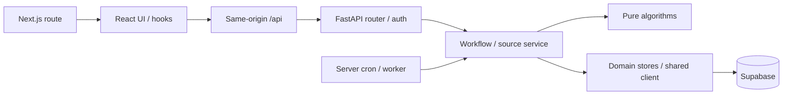

# สถาปัตยกรรม ClearPath

## เส้นทางหลัก

Production VPS ใช้ Caddy ส่ง `/api/*` ไปยัง `backend/main.py` ผ่าน Uvicorn และส่งหน้าเว็บไปยัง Next.js standalone ดู [VPS deployment](runbooks/vps-deployment.md) โดย `backend/main.py` ประกอบ routers ใต้ `/api` Frontend ไม่ถือ server keys และไม่เรียก database ด้วยสิทธิ์ server

## การไหลของข้อมูล

| ระบบ           | ลำดับอ่านโค้ด                                                                                       |
| -------------- | --------------------------------------------------------------------------------------------------- |
| แผนที่         | `PersistentMapPage` → `useMapPage` → data hooks → API client → routers/services                     |
| ส่งรายงาน      | `ReportForm` → `useReportDraft` → capture/draft → OCR → automatic review → persistence/presentation |
| แหล่งข้อมูล    | Scheduled sync → external source services → stored observations/grid → public APIs                  |
| คำขอช่วยวัด    | Request UI → measurement router/service → ownership/eligibility → persistence/notifications         |
| คะแนนและ Trust | XP facade/accounts/rewards และ community-trust workflow → pure policy functions/ledger              |
| LINE           | Notification preferences → server queue/cron → dedicated delivery worker → provider                 |

### รายงาน

1. ตรวจ identity, capture proof, GPS และ exact duplicate
2. เก็บ original/clean image ใน private storage และสร้าง draft
3. อ่านตัวเลข PM2.5 จากภาพหลัก; เก็บ burst hashes และ extraction flags เป็น audit metadata
4. ผู้ใช้ตรวจข้อมูลแล้วส่ง draft ระบบตัดสิน approved/rejected อัตโนมัติด้วยผล OCR number-only
5. Presentation เปิดเฉพาะข้อมูลตามสิทธิ์ ใช้ public coordinates ที่ผ่าน obfuscation และ signed image URL 6. Reward/Trust/analytical eligibility เป็นคนละนโยบาย ไม่ใช้ความสำเร็จของโบนัสเป็นเงื่อนไขเผยแพร่รายงาน

Admin/Moderator dashboard เป็น read-only ทั้งคู่ แต่พิกัดจริงและ raw GPS/EXIF/audit metadata เปิดเฉพาะ Admin; Moderator เห็นพิกัดสาธารณะที่ปกปิดแล้ว พร้อมภาพ/ผล OCR/สถานะรายงาน

### ข้อมูลแผนที่

- Air4Thai observations และ CAMS forecasts มีคนละความหมายและเวลาแหล่งข้อมูล
- CAMS ใช้ generation ที่จัดเก็บครบและเผยแพร่แบบ atomic; point/map อ่าน source เดียวกัน
- Place IDW และ backend gap-fill ใช้เกณฑ์ต่างกันตาม README/AGENTS
- ประวัติ ข้อมูลเก่า missing และ unavailable ต้องไม่ถูกแสดงเป็นค่าปัจจุบัน

## ขอบเขตโมดูล

- Routers ตรวจ HTTP/auth แล้วส่งงานต่อ ไม่รวม business policy ไว้ใน endpoint
- Algorithms ไม่มี network/DB; services เป็นผู้จัด I/O
- `supabase_client` เป็น facade ของ domain stores เพื่อให้ workflow มี boundary เดียว
- XP มี runtime state/control owner เดียว; แยก accounts กับ rewards โดยรักษา legacy settlements ที่ยังจำเป็น
- UI-only types ไม่ export ผ่าน API contract barrel
- ทุกขนาดจอใช้ `.cp-mobile-frame` ≤430px และ container queries ไม่แยก desktop application

## สิ่งที่ไม่ควรลบเพราะไม่ปรากฏบนหน้าจอ

Cron/worker, authorization, retention, audit, account erasure, recovery tooling, migration history, PWA/offline handling, API contracts และ retained-feature tests เป็นส่วนของระบบจริง

CAMS raster worker ถูกเรียกผ่าน `new URL(..., import.meta.url)` และ liquid-glass ถูกโหลดแบบ dynamic จึงต้องตรวจเส้นทางเหล่านี้นอกเหนือจาก static import ส่วน vendor license และ attribution ของ geometry ต้องอยู่กับ source ที่ใช้งาน

## หลักฐานและข้อจำกัด

Automated tests ยืนยันพฤติกรรมของโค้ดและ synthetic fixtures ไม่ใช่หลักฐานความแม่นยำของเซนเซอร์หรือ field trial เครื่องมือ/ผลทดลอง offline อยู่ใน archive ภายนอก แยกจากระบบที่กำลังนำเสนอ
