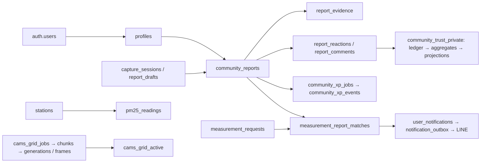

# หน้าที่และสถานะตาราง ClearPath — ตรวจ production 17 พฤศจิกายน 2569

ตรวจจาก catalog ของ `kmvxwfrmmictzuxbsncr` เวลา 2026-11-16T19:06:13.009716+00:00 เทียบกับ deployed commit `155fd3f` และฟังก์ชัน SQL ที่ติดตั้งจริง รอบนี้อ่านอย่างเดียว ไม่แก้ schema ไม่ลบข้อมูล ไม่ commit/push/deploy และไม่สร้าง backup ใน Supabase

## ขอบเขตและข้อจำกัด

- ตารางของแอป 78 ตาราง: public 64, private 4, community_trust_private 10
- ตารางระบบ/บริการ 53 ตาราง รวม partition; รวมตารางจริงทั้งหมด 131 ตาราง
- views 44 ตัว: review 41, extensions 2, vault 1; view ปกติไม่เก็บสำเนาข้อมูล
- ขนาดฐานข้อมูล 220.13 MiB โดย pg_database_size; ไม่ใช่ disk utilization/WAL หรือขนาดไฟล์ใน Storage และไม่ใช่การรับรอง free disk
- คำว่า “มีทางใช้งาน” หมายถึงพบ backend/SQL reference ไม่ได้ยืนยันว่า feature flag เปิดทุกตัวหรือมีการเรียกจริงล่าสุด
- ตารางว่างหรือค่า estimated_rows เป็นศูนย์ ไม่ได้พิสูจน์ว่าเลิกใช้; ไม่ทำ COUNT(*) ทุกตารางหรืออ่านข้อมูลส่วนตัวเพื่อจัดทำรายงานนี้
- catalog ไม่ใช่ full backup; ไม่ได้ทดสอบ load/restore หรือทำ security audit ครบทุก policy ในรอบนี้
- ไฟล์ใน working tree มีงานแก้ค้างอื่น จึงใช้ deployed HEAD เป็นหลักในการอธิบาย runtime ไม่ใช้ไฟล์ที่ยังไม่ deploy มารับรอง production

## สิ่งที่พบและควรจัดการต่อ

1. `forecast_provider_snapshots` ประมาณ 120.79 MiB และ `private.identifier_aliases` ประมาณ 62.17 MiB รวมประมาณ 83% ของฐานข้อมูล ต้องจัดการ CAMS cutover/retention และ compatibility aliases อย่างมีหลักฐาน ไม่ใช่ลบตารางเล็กที่จำเป็น
2. CAMS มีทั้งกริดและ snapshot รายสถานีใน schema และโค้ด deployed จึงยังต้องตรวจ feature flags/การอ่านจริงก่อน retire snapshot; staging chunks เป็นข้อมูลชั่วคราวระหว่างดึง ไม่ใช่แหล่งพยากรณ์ที่ควรเก็บถาวร
3. `report_reviews` เป็นตัวเลือกให้ตรวจ retirement ต่อ: ไม่พบ business read/write โดยตรงจาก backend/SQL bodies ที่อ่าน แต่ยังมี FK/trigger/view/identifier compatibility; ยังไม่สรุปว่าลบปลอดภัย
4. `community_device_evaluations` และ `community_evidence_outcomes` เป็นข้อมูลประเมินเก่า แต่ SQL ingest/reconcile/trigger ยังอ้างอิง จึงต้อง retire ทั้ง workflow และตรวจผลต่อคะแนน/audit ก่อน
5. `report_drafts`, capture sessions, CAMS chunks/jobs, outbox, webhook queues, rate limits และ logs ต้องมี retention ที่ทำงานจริง; ไม่ควรลบทิ้งเพราะเป็นกลไก retry/deduplication
6. ตาราง public ทั้ง 64 เปิด RLS ใน catalog; ข้อนี้ไม่เท่ากับตรวจพิสูจน์ว่า policy ทุกตัวถูกต้อง
7. AQI ถูกถอดจาก public/review stations และ pm25_readings แล้ว; `color`/`level` ใน stations ยังมีอยู่ เป็นข้อมูล derived ที่อาจทบทวนได้ แต่ response ยังต้องมีการจัดระดับ PM2.5
8. เวลาไทย: `review.stations` และ `review.pm25_readings` มีช่อง `*_bangkok`; ตารางจริงเก็บ timestamptz เดิม ไม่เปลี่ยนเวลาจริงของข้อมูล

## public: ตารางหลักของแอป

### บัญชีผู้ใช้และความเป็นส่วนตัว

| ตาราง                      | หน้าที่                                                                                        | ขนาด MiB รวม index/TOAST |
| -------------------------- | ---------------------------------------------------------------------------------------------- | -----------------------: |
| `profiles`                 | โปรไฟล์ใน ClearPath: ชื่อ รูป บทบาท และคะแนนสะสม; auth_user_id เชื่อมบัญชีล็อกอินใน auth.users |                     0.06 |
| `account_privacy_requests` | คำขอลบบัญชี/ข้อมูลส่วนตัว พร้อมสถานะและเวลาที่ดำเนินการ เพื่อให้ทำต่อได้หากงานสะดุด            |                     0.06 |

### สถานีและข้อมูล PM2.5

| ตาราง           | หน้าที่                                                                                     | ขนาด MiB รวม index/TOAST |
| --------------- | ------------------------------------------------------------------------------------------- | -----------------------: |
| `stations`      | ทะเบียนสถานี Air4Thai: ชื่อ พิกัด พื้นที่ และค่า PM2.5 ล่าสุด เป็นข้อมูลสำหรับหมุดสถานี     |                     0.18 |
| `pm25_readings` | ประวัติ PM2.5 รายสถานีตามเวลา ใช้กราฟย้อนหลังและแผนที่ย้อนหลัง; แยกเวลาต้นทางกับเวลารับเข้า |                     3.73 |
| `sync_runs`     | บันทึกผลการดึง Air4Thai แต่ละรอบ จำนวนสถานี/ข้อมูล เวลา และข้อผิดพลาด ใช้ติดตามความสด       |                     0.23 |

### CAMS และพยากรณ์

| ตาราง                         | หน้าที่                                                                                                                                         | ขนาด MiB รวม index/TOAST |
| ----------------------------- | ----------------------------------------------------------------------------------------------------------------------------------------------- | -----------------------: |
| `cams_grid_definitions`       | แกนละติจูด/ลองจิจูดและรหัสกริด กำหนดว่าตำแหน่งในอาร์เรย์ตรงกับพื้นที่ใด                                                                         |                     0.03 |
| `cams_grid_generations`       | หัวชุดข้อมูลกริดแต่ละรุ่น มีสถานะ เวลาดึง ช่วงเวลาพยากรณ์ และ fingerprint                                                                       |                     0.10 |
| `cams_grid_frames`            | ค่า PM2.5 ทั้งกริดของแต่ละชั่วโมง ผูกกับ generation; ใช้สร้างพื้นผิวพยากรณ์และอ่านค่าตามพิกัด                                                   |                     1.04 |
| `cams_grid_active`            | ตัวชี้ generation ที่เผยแพร่ใช้งานอยู่ ช่วยสลับชุดข้อมูลเมื่อพร้อมทั้งชุด                                                                       |                     0.04 |
| `cams_grid_jobs`              | งานดึงกริดแบบแบ่ง batch มี cursor, lease, จำนวนครั้งลอง และข้อผิดพลาด เพื่อทำต่อ/กัน worker ซ้อน                                                |                     0.11 |
| `cams_grid_chunks`            | ข้อมูลระหว่างดึงกริดที่ยังไม่ประกอบเป็นชุดสมบูรณ์ เป็น staging ของ job ไม่ใช่ชุดเผยแพร่อีกชุด                                                   |                     0.39 |
| `forecast_provider_snapshots` | พยากรณ์รายสถานีจากผู้ให้บริการ เก็บเวลาที่ออกพยากรณ์/เวลาที่พยากรณ์และค่า PM2.5; โค้ด deployed ยังมีทางอ่าน/เขียน ต้องจบ cutover ก่อนพิจารณาถอด |                   120.79 |
| `forecast_provider_sync_runs` | ผลการดึงพยากรณ์แต่ละรอบ รวมจำนวนสถานี/snapshot ข้อผิดพลาด และ metadata ที่ snapshot อ้างกลับ                                                    |                     0.11 |

### รายงานจากผู้ใช้และหลักฐาน

| ตาราง               | หน้าที่                                                                                                               | ขนาด MiB รวม index/TOAST |
| ------------------- | --------------------------------------------------------------------------------------------------------------------- | -----------------------: |
| `capture_sessions`  | สิทธิ์/เซสชันถ่ายภาพที่ server ออกให้ มีเวลาหมดอายุและเวลาที่ใช้แล้ว ช่วยตรวจ provenance และการใช้ซ้ำ                 |                     0.08 |
| `report_drafts`     | ร่างชั่วคราวก่อนส่งจริง: รูป พิกัด เวลา OCR และสถานะประมวลผล ต้องมีอายุเก็บจำกัด                                      |                     0.23 |
| `community_reports` | รายการรายงานหลักที่ส่งแล้ว: PM2.5 ที่อ่านจากภาพ สถานะ เหตุผล พิกัดสาธารณะ/ข้อมูล audit และตัวนับ engagement           |                     0.35 |
| `report_evidence`   | หลักฐานประกอบรายงาน: พิกัดจริง hash ภาพ OCR และข้อมูลการรับภาพ มี retention/audit hold; ไม่ใช่ข้อมูลที่ควรเปิดสาธารณะ |                     0.16 |
| `public_map_events` | เหตุการณ์เปลี่ยนข้อมูลสาธารณะบนแผนที่ ให้ client/ระบบติดตามการเปลี่ยนแปลงโดยอ้างอิง entity                            |                     0.08 |

### ความคิดเห็น ปฏิกิริยา และคะแนนเดิม

| ตาราง               | หน้าที่                                                                                                                                                                                     | ขนาด MiB รวม index/TOAST |
| ------------------- | ------------------------------------------------------------------------------------------------------------------------------------------------------------------------------------------- | -----------------------: |
| `report_reactions`  | Like/Dislike ล่าสุดของผู้ใช้ต่อรายงาน พร้อม reason/geofence policy เป็นสถานะปฏิกิริยาสังคม                                                                                                  |                     0.08 |
| `report_comments`   | ข้อความความคิดเห็น ผู้เขียน รายงานที่เกี่ยวข้อง และสถานะข้อความ                                                                                                                             |                     0.05 |
| `report_reviews`    | ข้อมูล review/rating/weight แบบเก่า ไม่ใช่ตาราง Comment ปัจจุบัน; ไม่พบทางอ่าน/เขียนธุรกิจโดยตรงใน deployed backend/SQL bodies ที่ตรวจ แต่ยังมี FK/trigger/view ต้องตรวจ dependency ก่อนถอด |                     0.05 |
| `reputation_events` | ledger คะแนน reputation รุ่นเดิม มีเหตุผลและ idempotency key; ยังมี SQL/ทางอ่านคะแนนเดิม ไม่ควรลบโดยดูเพียงว่ามี Trust รุ่นใหม่แล้ว                                                         |                     0.11 |

### XP ภารกิจ และนโยบายการมีส่วนร่วม

| ตาราง                            | หน้าที่                                                                                                                                                                                        | ขนาด MiB รวม index/TOAST |
| -------------------------------- | ---------------------------------------------------------------------------------------------------------------------------------------------------------------------------------------------- | -----------------------: |
| `community_xp_accounts`          | ตัวตนในระบบ XP/อันดับ: member ID/code ชื่อแฝง การซ่อนตัว และวิธีแสดงตัวตน ผูก profiles                                                                                                         |                     0.08 |
| `community_xp_events`            | ledger การได้/ย้อน XP แต่ละรายการ พร้อมรุ่นนโยบายและหลักฐานอ้างอิง เป็นฐานตรวจสอบและคำนวณคะแนน                                                                                                 |                     0.26 |
| `community_xp_jobs`              | คิวประมวลผล XP ของรายงาน เก็บ snapshot ตอนเกิดเหตุและรุ่นนโยบายเพื่อ retry โดยไม่ให้คะแนนซ้ำ                                                                                                   |                     0.22 |
| `community_xp_control`           | สวิตช์เปิด/พักและข้อมูล reset ของระบบ XP เดิม ยังคงใช้เพื่อความเข้ากันได้                                                                                                                      |                     0.03 |
| `community_coverage_missions`    | ภารกิจเติมข้อมูลพื้นที่ขาดแคลน: พื้นที่ รัศมี อายุงาน และรายงานที่ทำภารกิจสำเร็จ                                                                                                               |                     0.41 |
| `community_help_claims`          | บันทึกการเริ่มช่วยคำขอตรวจวัด เป็นหลักฐานเวลา/ผู้ช่วย ไม่ใช่คำขอตรวจวัดฉบับหลัก                                                                                                                |                     0.07 |
| `community_season_results`       | ผลอันดับรายเดือนที่ freeze แล้ว พร้อม revision/ผลก่อนหน้า ทำให้ประวัติไม่เปลี่ยนตามคะแนนปัจจุบัน                                                                                               |                     0.02 |
| `community_policy_release`       | ค่าควบคุมนโยบายชุมชนและหลักฐานการเปิดใช้ v2-compatible policy; มี SQL ใช้อ้างอิง แม้ชื่อรุ่นต่างจาก UI ปัจจุบัน                                                                                |                     0.03 |
| `community_device_evaluations`   | ข้อมูลผลประเมินเครื่อง/วิธีวัดอิสระรุ่นเดิม: วิธี เครื่องอ้างอิง เงื่อนไข อายุผล และ provenance; local เตรียมถอด ingest แล้ว แต่ deployed commit 155fd3f ยังมี CLI/service และ SQL ingest อยู่ |                     0.03 |
| `community_evidence_outcomes`    | ผลประเมิน/ข้อค้นพบต่อหลักฐาน มี scope/outcome/provenance และผลต่อ contribution; ยังมี SQL reconcile/trigger ห้ามเหมารวมเป็นข้อมูลทิ้ง                                                          |                     0.04 |
| `contribution_v3_control`        | การเปิด/พัก contribution-v3 เวลาเริ่ม ภารกิจ และเอกสารอ้างอิง; SQL worker/อันดับใช้ตัดสินนโยบาย                                                                                                |                     0.03 |
| `contribution_v3_release_events` | audit การเปลี่ยนค่าปล่อย contribution-v3 โดย operator ไม่ใช่ ledger XP ของผู้ใช้                                                                                                               |                     0.03 |

### คำขอตรวจวัดและผู้ช่วย

| ตาราง                                  | หน้าที่                                                                                             | ขนาด MiB รวม index/TOAST |
| -------------------------------------- | --------------------------------------------------------------------------------------------------- | -----------------------: |
| `measurement_requests`                 | คำขอให้ช่วยวัด PM2.5 ณ สถานที่/รัศมีที่เลือก มีช่วงเวลา สถานะ กันส่งซ้ำ และรายงานผลลัพธ์            |                     0.21 |
| `measurement_request_recipients`       | รายชื่อผู้ช่วยที่จับคู่กับคำขอแล้ว พร้อมข้อมูลแหล่งจับคู่/การปฏิเสธ เพื่อ dispatch ต่อและกันแจ้งซ้ำ |                     0.08 |
| `measurement_helper_presence`          | สถานะเปิดรับช่วยและพิกัดล่าสุดของผู้ช่วยแบบ presence; ต่างจากพื้นที่ประจำที่บันทึกไว้               |                     0.05 |
| `measurement_helper_locations`         | สถานที่/พื้นที่ประจำที่ผู้ช่วยตั้งรับงาน เช่น บ้านหรือที่ทำงาน แยกเป็น slot และเปิดปิดได้           |                     0.05 |
| `measurement_request_control`          | สวิตช์เปิดระบบคำขอแบบผู้ช่วยลงทะเบียนและเวลาเริ่มเปิดใช้                                            |                     0.02 |
| `measurement_report_jobs`              | คิวจับคู่รายงานใหม่กับคำขอที่กำลังรอผล ทำงานต่อได้หลังบันทึกรายงานสำเร็จ                            |                     0.05 |
| `measurement_report_matches`           | ความสัมพันธ์รายงาน–คำขอที่รายงานนั้นตอบได้ รองรับหลายคำขอ/หลายรายการ                                |                     0.04 |
| `measurement_notification_batches`     | หัวกลุ่มรวมการแจ้งคำขอของผู้ช่วยแต่ละคนภายในช่วงเวลาหนึ่ง ลดการส่ง LINE ถี่                         |                     0.04 |
| `measurement_notification_batch_items` | รายการคำขอที่อยู่ในกลุ่มแจ้งเตือน เชื่อม batch, request และ user                                    |                     0.04 |
| `measurement_delivery_leases`          | lock ชั่วคราวของ event ส่งคำขอ ให้ worker เดียวถือสิทธิ์ส่งในแต่ละช่วง                              |                     0.04 |

### การแจ้งเตือนและ LINE

| ตาราง                      | หน้าที่                                                                                                    | ขนาด MiB รวม index/TOAST |
| -------------------------- | ---------------------------------------------------------------------------------------------------------- | -----------------------: |
| `notification_preferences` | การยินยอมและตัวเลือกแจ้งเตือน ประเภท พื้นที่ เกณฑ์ฝุ่น ช่องทาง quiet hours และ timezone                    |                     0.05 |
| `user_notifications`       | กล่องแจ้งเตือนในแอปของผู้ใช้ รวมข้อความ ลิงก์ อ่านแล้วหรือยัง และ key กันรายการซ้ำ                         |                     0.14 |
| `notification_outbox`      | คิวส่งภายนอก: payload สถานะ จำนวนลองใหม่ lease และข้อมูลผู้ให้บริการ แยกการสร้าง notification ออกจากการส่ง |                     0.17 |
| `line_notification_links`  | การเชื่อมบัญชี ClearPath กับ LINE user พร้อมรหัสเชื่อมที่ hash แล้ว อายุรหัส และสถานะ active               |                     0.09 |
| `line_webhook_inbox`       | คิว event จาก LINE ที่รับไว้ก่อน ประมวลผลต่อด้วย lease/retry และสถานะว่าใช้ผลแล้วหรือยัง                   |                     0.05 |
| `line_webhook_events`      | ทะเบียน LINE event ที่ประมวลผลแล้วพร้อมหมดอายุ ป้องกัน replay/ส่ง event เดิมซ้ำ                            |                     0.05 |
| `line_user_event_cursors`  | event ล่าสุดต่อ LINE user ช่วยกัน event เก่าหรือมาผิดลำดับเขียนทับสถานะใหม่                                |                     0.02 |
| `line_provider_budget`     | ตัวนับงบ/โควตาการส่ง LINE ตาม bucket และเวลาหมดอายุ ใช้คุมปริมาณการส่ง                                     |                     0.03 |
| `alert_events`             | หัวเหตุการณ์แจ้งเตือน เช่น ฝุ่น/hotspot ระดับความรุนแรง พื้นที่ ข้อความ และผลการส่ง ไม่ใช่ inbox รายบุคคล  |                     0.03 |
| `air_alert_locations`      | พิกัดสำหรับประเมินแจ้งเตือนฝุ่นของผู้ใช้ พร้อม accuracy และเวลารับ/เวลาวัด แยกจาก public coordinates       |                     0.07 |
| `air_alert_states`         | สถานะประเมินฝุ่นล่าสุดต่อ user มี revision และ lease ลดการประเมิน/ส่งซ้ำ                                   |                     0.08 |
| `air_alert_daily_limits`   | เพดาน/การกันซ้ำของ alert ต่อวันและระดับความรุนแรง ไม่ใช่ค่าฝุ่นย้อนหลัง                                    |                     0.02 |

### ข่าว ข้อมูลภายนอก และงานระบบ

| ตาราง                   | หน้าที่                                                                                                  | ขนาด MiB รวม index/TOAST |
| ----------------------- | -------------------------------------------------------------------------------------------------------- | -----------------------: |
| `external_feed_sources` | สถานะและ cache ล่าสุดของ feed ภายนอก เช่น ข่าว/hotspot: เวลาครั้งถัดไป validators lease และ snapshot     |                     0.18 |
| `external_feed_runs`    | ประวัติการดึง feed แต่ละรอบ จำนวนรับ/กรอง/ซ้ำ และข้อผิดพลาด ใช้ผ่าน SQL RPC                              |                     0.24 |
| `external_news_items`   | ข่าวภายนอกที่กรองและกันซ้ำแล้ว มี URL ต้นทาง ชื่อข่าว แหล่งข่าว และวันเผยแพร่ ใช้ผ่าน SQL RPC            |                     0.38 |
| `announcements`         | ประกาศของแพลตฟอร์ม พร้อมพื้นที่ ประเภท วันหมดอายุ และสถานะ; dashboard ปัจจุบันเป็น read-only             |                     0.04 |
| `activities`            | นิยามกิจกรรม/กติกา/เป้าหมาย/รางวัลและช่วงเวลา ไม่ใช่รายการ XP ที่แจกแล้ว                                 |                     0.02 |
| `audit_logs`            | บันทึกการกระทำสำคัญ actor/action/entity/details เพื่อสอบย้อนกลับ ไม่ใช่ application debug log ทุกข้อความ |                     0.10 |
| `data_issue_reports`    | คำแจ้งปัญหาคุณภาพข้อมูลจากผู้ใช้ พร้อมหมวด อ้างอิง ข้อความ และสถานะติดตาม                                |                     0.04 |
| `rate_limit_windows`    | ตัวนับคำขอของ actor/action ต่อหน้าต่างเวลา ป้องกันเรียก API ถี่; ใช้ผ่าน SQL RPC                         |                     0.09 |

## private

| ตาราง                     | หน้าที่                                                                                                                                                               |
| ------------------------- | --------------------------------------------------------------------------------------------------------------------------------------------------------------------- |
| `account_erasure_jobs`    | สถานะภายในงานลบบัญชี รวม Auth ID และ path รูปที่ต้องลบ ให้ทำงานต่อได้โดยไม่ทิ้งไฟล์ค้าง                                                                               |
| `history_retention_state` | เวลาและผลรอบ cleanup ล่าสุด ช่วย throttle งาน retention ไม่ให้ล้างซ้ำถี่เกิน                                                                                          |
| `identifier_aliases`      | mapping legacy UUID → numeric ID/code เพื่อให้ URL/คำขอเก่าและฟังก์ชัน compatibility ยัง resolve ได้; ใช้พื้นที่สูง ต้อง retire mapping แยกตาม entity อย่างมีเงื่อนไข |
| `identifier_control`      | สถานะรุ่น schema ID และ maintenance guard ป้องกันเขียนระหว่าง cutover                                                                                                 |

## community_trust_private

| ตาราง              | หน้าที่                                                                                                     |
| ------------------ | ----------------------------------------------------------------------------------------------------------- |
| `control`          | การเปิดเก็บ/เปิดแสดง Trust นโยบาย อายุเก็บ และ cursor reconciliation                                        |
| `control_events`   | audit การเปลี่ยนสถานะ/นโยบาย Trust โดย operator                                                             |
| `events`           | ledger เหตุการณ์โหวต/ถอน/ข้อค้นพบพร้อมผล eligibility และเหตุผล เป็นหลักฐานสำหรับ replay                     |
| `reactions`        | สถานะปฏิกิริยาที่เข้า Trust ต่อ voter/report พร้อมวันแรกที่ยอมรับและ tombstone ไม่ใช่ปุ่ม social อย่างเดียว |
| `daily_slots`      | รายการที่ถูกเลือกเป็นสิทธิ์ล่าสุดของผู้โหวตต่อผู้รายงานต่อวัน คุมจำนวนเสียงตามนโยบาย                        |
| `pair_days`        | วันโหวตที่รับเข้าของคู่ voter–reporter ใช้จำกัดอิทธิพลจากคู่เดิมซ้ำหลายวัน                                  |
| `daily_aggregates` | ผลรวมบวก/ลบและน้ำหนักรายวันต่อผู้รายงาน เป็นข้อมูลคำนวณที่ rebuild จาก ledger ได้                           |
| `projections`      | ผล Trust ที่คำนวณแล้วพร้อม ledger watermark และเวลา ลดการ replay ทุกครั้งที่เปิดหมุด/โปรไฟล์                |
| `holds`            | ช่วงพักรับผลคะแนนชั่วคราวเมื่อมี cohort โหวตถี่ตามนโยบาย ไม่ใช่การตัดสินว่าทุจริต                           |
| `review_requests`  | คำขอทบทวน Trust ที่ผู้ใช้ส่ง พร้อมขอบเขตรายงาน/วันและสถานะติดตาม; ไม่ใช่ Admin แก้คะแนนโดยตรง               |

## ความสัมพันธ์ที่ใช้อธิบายระบบ

แผนภาพเป็น data flow แบบย่อ ไม่ใช่ทุกลูกศรเป็น FK; FK จริงระบุในภาคผนวกของแต่ละตาราง

## ตารางระบบที่ Supabase/extension ดูแล

การมีตารางรองรับ SSO, MFA, passkeys, OAuth server หรือ Vector ไม่ได้แปลว่า ClearPath เปิดใช้ทุกฟีเจอร์ ห้ามลบ internal table จากการที่ UI ไม่ได้ใช้ฟีเจอร์นั้น

Auth เก็บบัญชี/identity/session; profiles เป็นข้อมูลของแอป ดู [Supabase User Management](https://supabase.com/docs/guides/auth/managing-user-data). Storage schema เก็บ metadata ของไฟล์ ควรจัดการผ่าน Storage API ไม่ลบ metadata ด้วย SQL ดู [Storage Schema](https://supabase.com/docs/guides/storage/schema/design).

### auth

| ตาราง                    | หน้าที่                                                                           |
| ------------------------ | --------------------------------------------------------------------------------- |
| `audit_log_entries`      | ประวัติเหตุการณ์ด้าน Auth                                                         |
| `custom_oauth_providers` | การตั้งค่า OAuth/OIDC provider เพิ่มเติม                                          |
| `flow_state`             | สถานะชั่วคราวของ login/linking/PKCE                                               |
| `identities`             | ตัวตนจาก provider เช่น Google ที่เชื่อมกับ users                                  |
| `instances`              | metadata ของ Auth instance                                                        |
| `mfa_amr_claims`         | หลักฐานวิธียืนยันตัวตนที่ผูกกับ session                                           |
| `mfa_challenges`         | challenge สำหรับตรวจปัจจัย MFA                                                    |
| `mfa_factors`            | ปัจจัยยืนยันตัวตนหลายขั้น เช่น TOTP/โทรศัพท์/WebAuthn                             |
| `mfa_recovery_code_sets` | ชุด recovery codes และสถานะล็อก/จำนวนครั้งล้มเหลว                                 |
| `mfa_recovery_codes`     | hash ของ recovery code และเวลาที่ใช้แล้ว                                          |
| `oauth_authorizations`   | คำขอและผลอนุญาต OAuth เมื่อตัว Auth ทำหน้าที่ OAuth server                        |
| `oauth_client_states`    | state ชั่วคราวของ OAuth client flow                                               |
| `oauth_clients`          | client ที่ลงทะเบียนใช้ OAuth server                                               |
| `oauth_consents`         | การยินยอม scope ของผู้ใช้ต่อ OAuth client                                         |
| `one_time_tokens`        | token ใช้ครั้งเดียวสำหรับขั้นตอนยืนยัน/กู้คืน/เชื่อมบัญชี                         |
| `refresh_tokens`         | ข้อมูลต่ออายุ session/token ที่ Auth ดูแล                                         |
| `saml_providers`         | การตั้งค่า identity provider SAML                                                 |
| `saml_relay_states`      | สถานะ redirect/relay ระหว่าง SAML flow                                            |
| `schema_migrations`      | รุ่น schema ภายใน Auth                                                            |
| `scim_tokens`            | token สำหรับ provision ผู้ใช้ด้วย SCIM                                            |
| `scim_users`             | mapping ผู้ใช้/สถานะการ provision จาก SCIM                                        |
| `sessions`               | เซสชันเข้าสู่ระบบและระดับการยืนยันตัวตน                                           |
| `sso_domains`            | โดเมนที่ผูกผู้ให้บริการ SSO                                                       |
| `sso_providers`          | ทะเบียน provider สำหรับ SSO                                                       |
| `users`                  | บัญชีเข้าสู่ระบบหลักของ Supabase Auth; เก็บข้อมูลยืนยันตัวตน ไม่ใช่โปรไฟล์สาธารณะ |
| `webauthn_challenges`    | challenge สำหรับ passkey/WebAuthn                                                 |
| `webauthn_credentials`   | public-key credential ของ passkey/WebAuthn                                        |

### storage

| ตาราง                           | หน้าที่                                                |
| ------------------------------- | ------------------------------------------------------ |
| `bucket_lifecycle_states`       | สถานะ/cursor/lease ของงาน lifecycle ต่อ bucket         |
| `buckets`                       | นิยาม bucket สิทธิ์ public/private และข้อจำกัดไฟล์     |
| `buckets_analytics`             | metadata ของ Analytics buckets                         |
| `buckets_vectors`               | metadata ของ Vector buckets                            |
| `lifecycle_abandoned_artifacts` | metadata อาร์ติแฟกต์ที่งาน lifecycle ต้องตามเก็บ       |
| `migrations`                    | ประวัติ schema ของบริการ Storage                       |
| `objects`                       | metadata/path ของไฟล์; เนื้อไฟล์จริงไม่ได้อยู่ในแถวนี้ |
| `s3_multipart_uploads`          | สถานะ upload ไฟล์แบบแบ่งส่วนที่ยังดำเนินการ            |
| `s3_multipart_uploads_parts`    | metadata แต่ละส่วนของ multipart upload                 |
| `vector_indexes`                | นิยาม index ภายใน Vector bucket                        |

### cron

| ตาราง             | หน้าที่                                     |
| ----------------- | ------------------------------------------- |
| `job`             | นิยาม schedule และคำสั่งของ pg_cron         |
| `job_run_details` | ผลการรัน pg_cron แต่ละรอบ; ต้องระวัง log โต |

### net

| ตาราง                | หน้าที่                                    |
| -------------------- | ------------------------------------------ |
| `_http_response`     | ผลตอบ HTTP ของ pg_net เพื่อดูผล/ข้อผิดพลาด |
| `http_request_queue` | คิว HTTP ของ pg_net ที่ส่งแบบ asynchronous |

### vault

| ตาราง     | หน้าที่                                    |
| --------- | ------------------------------------------ |
| `secrets` | ข้อมูลลับที่เข้ารหัสและ metadata ของ Vault |

### supabase_migrations

| ตาราง               | หน้าที่                                                                       |
| ------------------- | ----------------------------------------------------------------------------- |
| `schema_migrations` | ประวัติ migration ของโปรเจกต์ที่ apply แล้ว แยกจาก migration ของ Auth/Storage |

### realtime

| ตาราง                 | หน้าที่                                                                         |
| --------------------- | ------------------------------------------------------------------------------- |
| `messages`            | ตารางแม่แบบ partitioned ของ Realtime messages                                   |
| `messages_2026_11_13` | partition ของ realtime.messages สำหรับวันที่ 2026-11-13 ไม่ใช่สำเนาข้อมูลทุกวัน |
| `messages_2026_11_14` | partition ของ realtime.messages สำหรับวันที่ 2026-11-14 ไม่ใช่สำเนาข้อมูลทุกวัน |
| `messages_2026_11_15` | partition ของ realtime.messages สำหรับวันที่ 2026-11-15 ไม่ใช่สำเนาข้อมูลทุกวัน |
| `messages_2026_11_16` | partition ของ realtime.messages สำหรับวันที่ 2026-11-16 ไม่ใช่สำเนาข้อมูลทุกวัน |
| `messages_2026_11_17` | partition ของ realtime.messages สำหรับวันที่ 2026-11-17 ไม่ใช่สำเนาข้อมูลทุกวัน |
| `messages_2026_11_18` | partition ของ realtime.messages สำหรับวันที่ 2026-11-18 ไม่ใช่สำเนาข้อมูลทุกวัน |
| `messages_2026_11_19` | partition ของ realtime.messages สำหรับวันที่ 2026-11-19 ไม่ใช่สำเนาข้อมูลทุกวัน |
| `schema_migrations`   | รุ่น schema ของ Realtime                                                        |
| `subscription`        | ทะเบียน subscription/filter/claims ของ Realtime                                 |

## Views สำหรับตรวจข้อมูล

`review.*` เป็นมุมมองของตารางจริง ช่วยให้เห็น code/ความสัมพันธ์อ่านง่าย ไม่ใช่ฐานข้อมูลสำรองอีกชุด ต้องดูนิยามจริงเพราะแต่ละ view เลือกคอลัมน์ไม่เท่ากัน การมี view ไม่ทำให้ข้อมูลถูกเก็บซ้ำ

| View                                    | หน้าที่                                                                                                        |
| --------------------------------------- | -------------------------------------------------------------------------------------------------------------- |
| `extensions.pg_stat_statements`         | สถิติ query ของ pg_stat_statements                                                                             |
| `extensions.pg_stat_statements_info`    | metadata/สถานะการเก็บสถิติ pg_stat_statements                                                                  |
| `review.activities`                     | view สำหรับตรวจ activities ด้วยรหัสอ่านง่าย/ข้อมูลที่เลือกจากตารางจริง ไม่มีสำเนาแถวอีกชุด                     |
| `review.alert_events`                   | view สำหรับตรวจ alert_events ด้วยรหัสอ่านง่าย/ข้อมูลที่เลือกจากตารางจริง ไม่มีสำเนาแถวอีกชุด                   |
| `review.announcements`                  | view สำหรับตรวจ announcements ด้วยรหัสอ่านง่าย/ข้อมูลที่เลือกจากตารางจริง ไม่มีสำเนาแถวอีกชุด                  |
| `review.audit_logs`                     | view สำหรับตรวจ audit_logs ด้วยรหัสอ่านง่าย/ข้อมูลที่เลือกจากตารางจริง ไม่มีสำเนาแถวอีกชุด                     |
| `review.cams_grid_active`               | view สำหรับตรวจ cams_grid_active ด้วยรหัสอ่านง่าย/ข้อมูลที่เลือกจากตารางจริง ไม่มีสำเนาแถวอีกชุด               |
| `review.cams_grid_chunks`               | view สำหรับตรวจ cams_grid_chunks ด้วยรหัสอ่านง่าย/ข้อมูลที่เลือกจากตารางจริง ไม่มีสำเนาแถวอีกชุด               |
| `review.cams_grid_definitions`          | view สำหรับตรวจ cams_grid_definitions ด้วยรหัสอ่านง่าย/ข้อมูลที่เลือกจากตารางจริง ไม่มีสำเนาแถวอีกชุด          |
| `review.cams_grid_frames`               | view สำหรับตรวจ cams_grid_frames ด้วยรหัสอ่านง่าย/ข้อมูลที่เลือกจากตารางจริง ไม่มีสำเนาแถวอีกชุด               |
| `review.cams_grid_generations`          | view สำหรับตรวจ cams_grid_generations ด้วยรหัสอ่านง่าย/ข้อมูลที่เลือกจากตารางจริง ไม่มีสำเนาแถวอีกชุด          |
| `review.cams_grid_jobs`                 | view สำหรับตรวจ cams_grid_jobs ด้วยรหัสอ่านง่าย/ข้อมูลที่เลือกจากตารางจริง ไม่มีสำเนาแถวอีกชุด                 |
| `review.capture_sessions`               | view สำหรับตรวจ capture_sessions ด้วยรหัสอ่านง่าย/ข้อมูลที่เลือกจากตารางจริง ไม่มีสำเนาแถวอีกชุด               |
| `review.community_help_claims`          | view สำหรับตรวจ community_help_claims ด้วยรหัสอ่านง่าย/ข้อมูลที่เลือกจากตารางจริง ไม่มีสำเนาแถวอีกชุด          |
| `review.community_reports`              | view สำหรับตรวจ community_reports ด้วยรหัสอ่านง่าย/ข้อมูลที่เลือกจากตารางจริง ไม่มีสำเนาแถวอีกชุด              |
| `review.community_xp_accounts`          | view สำหรับตรวจ community_xp_accounts ด้วยรหัสอ่านง่าย/ข้อมูลที่เลือกจากตารางจริง ไม่มีสำเนาแถวอีกชุด          |
| `review.community_xp_control`           | view สำหรับตรวจ community_xp_control ด้วยรหัสอ่านง่าย/ข้อมูลที่เลือกจากตารางจริง ไม่มีสำเนาแถวอีกชุด           |
| `review.community_xp_events`            | view สำหรับตรวจ community_xp_events ด้วยรหัสอ่านง่าย/ข้อมูลที่เลือกจากตารางจริง ไม่มีสำเนาแถวอีกชุด            |
| `review.community_xp_jobs`              | view สำหรับตรวจ community_xp_jobs ด้วยรหัสอ่านง่าย/ข้อมูลที่เลือกจากตารางจริง ไม่มีสำเนาแถวอีกชุด              |
| `review.data_issue_reports`             | view สำหรับตรวจ data_issue_reports ด้วยรหัสอ่านง่าย/ข้อมูลที่เลือกจากตารางจริง ไม่มีสำเนาแถวอีกชุด             |
| `review.forecast_provider_snapshots`    | view สำหรับตรวจ forecast_provider_snapshots ด้วยรหัสอ่านง่าย/ข้อมูลที่เลือกจากตารางจริง ไม่มีสำเนาแถวอีกชุด    |
| `review.forecast_provider_sync_runs`    | view สำหรับตรวจ forecast_provider_sync_runs ด้วยรหัสอ่านง่าย/ข้อมูลที่เลือกจากตารางจริง ไม่มีสำเนาแถวอีกชุด    |
| `review.line_notification_links`        | view สำหรับตรวจ line_notification_links ด้วยรหัสอ่านง่าย/ข้อมูลที่เลือกจากตารางจริง ไม่มีสำเนาแถวอีกชุด        |
| `review.line_webhook_events`            | view สำหรับตรวจ line_webhook_events ด้วยรหัสอ่านง่าย/ข้อมูลที่เลือกจากตารางจริง ไม่มีสำเนาแถวอีกชุด            |
| `review.measurement_delivery_leases`    | view สำหรับตรวจ measurement_delivery_leases ด้วยรหัสอ่านง่าย/ข้อมูลที่เลือกจากตารางจริง ไม่มีสำเนาแถวอีกชุด    |
| `review.measurement_helper_presence`    | view สำหรับตรวจ measurement_helper_presence ด้วยรหัสอ่านง่าย/ข้อมูลที่เลือกจากตารางจริง ไม่มีสำเนาแถวอีกชุด    |
| `review.measurement_request_recipients` | view สำหรับตรวจ measurement_request_recipients ด้วยรหัสอ่านง่าย/ข้อมูลที่เลือกจากตารางจริง ไม่มีสำเนาแถวอีกชุด |
| `review.measurement_requests`           | view สำหรับตรวจ measurement_requests ด้วยรหัสอ่านง่าย/ข้อมูลที่เลือกจากตารางจริง ไม่มีสำเนาแถวอีกชุด           |
| `review.notification_outbox`            | view สำหรับตรวจ notification_outbox ด้วยรหัสอ่านง่าย/ข้อมูลที่เลือกจากตารางจริง ไม่มีสำเนาแถวอีกชุด            |
| `review.notification_preferences`       | view สำหรับตรวจ notification_preferences ด้วยรหัสอ่านง่าย/ข้อมูลที่เลือกจากตารางจริง ไม่มีสำเนาแถวอีกชุด       |
| `review.pm25_readings`                  | view สำหรับตรวจ pm25_readings ด้วยรหัสอ่านง่าย/ข้อมูลที่เลือกจากตารางจริง ไม่มีสำเนาแถวอีกชุด                  |
| `review.profiles`                       | view สำหรับตรวจ profiles ด้วยรหัสอ่านง่าย/ข้อมูลที่เลือกจากตารางจริง ไม่มีสำเนาแถวอีกชุด                       |
| `review.public_map_events`              | view สำหรับตรวจ public_map_events ด้วยรหัสอ่านง่าย/ข้อมูลที่เลือกจากตารางจริง ไม่มีสำเนาแถวอีกชุด              |
| `review.rate_limit_windows`             | view สำหรับตรวจ rate_limit_windows ด้วยรหัสอ่านง่าย/ข้อมูลที่เลือกจากตารางจริง ไม่มีสำเนาแถวอีกชุด             |
| `review.report_comments`                | view สำหรับตรวจ report_comments ด้วยรหัสอ่านง่าย/ข้อมูลที่เลือกจากตารางจริง ไม่มีสำเนาแถวอีกชุด                |
| `review.report_drafts`                  | view สำหรับตรวจ report_drafts ด้วยรหัสอ่านง่าย/ข้อมูลที่เลือกจากตารางจริง ไม่มีสำเนาแถวอีกชุด                  |
| `review.report_evidence`                | view สำหรับตรวจ report_evidence ด้วยรหัสอ่านง่าย/ข้อมูลที่เลือกจากตารางจริง ไม่มีสำเนาแถวอีกชุด                |
| `review.report_reactions`               | view สำหรับตรวจ report_reactions ด้วยรหัสอ่านง่าย/ข้อมูลที่เลือกจากตารางจริง ไม่มีสำเนาแถวอีกชุด               |
| `review.report_reviews`                 | view สำหรับตรวจ report_reviews ด้วยรหัสอ่านง่าย/ข้อมูลที่เลือกจากตารางจริง ไม่มีสำเนาแถวอีกชุด                 |
| `review.reputation_events`              | view สำหรับตรวจ reputation_events ด้วยรหัสอ่านง่าย/ข้อมูลที่เลือกจากตารางจริง ไม่มีสำเนาแถวอีกชุด              |
| `review.stations`                       | view สำหรับตรวจ stations ด้วยรหัสอ่านง่าย/ข้อมูลที่เลือกจากตารางจริง ไม่มีสำเนาแถวอีกชุด                       |
| `review.sync_runs`                      | view สำหรับตรวจ sync_runs ด้วยรหัสอ่านง่าย/ข้อมูลที่เลือกจากตารางจริง ไม่มีสำเนาแถวอีกชุด                      |
| `review.user_notifications`             | view สำหรับตรวจ user_notifications ด้วยรหัสอ่านง่าย/ข้อมูลที่เลือกจากตารางจริง ไม่มีสำเนาแถวอีกชุด             |
| `vault.decrypted_secrets`               | view อ่านความลับที่ถอดรหัสตามสิทธิ์; ไม่ได้อ่านค่าความลับในการ review นี้                                      |

## ภาคผนวก: หลักฐาน schema / FK / ทางใช้งานรายตาราง

รายการ source reference เป็นหลักฐานค้นชื่อใน deployed backend/SQL source ไม่ใช่ runtime tracing; ชื่อทั่วไปเช่น control/events อาจมี false positive จึงไม่ใช้จำนวน match เป็นตัวตัดสินการลบ

### community_trust_private.control

การเปิดเก็บ/เปิดแสดง Trust นโยบาย อายุเก็บ และ cursor reconciliation

คอลัมน์: `singleton` (boolean), `policy_version` (text), `collecting_enabled` (boolean), `public_enabled` (boolean), `notice_ref` (text), `review_owner` (text), `review_channel` (text), `retention_days` (integer), `retention_ref` (text), `experiment_ref` (text), `privacy_ref` (text), `concurrency_ref` (text), `retention_last_ran_at` (timestamp with time zone), `reconcile_cursor` (bigint)

Backend references: `backend/main.py`, `backend/routers/community.py`, `backend/routers/cron.py`, `backend/services/community/community_trust.py`, `backend/services/community/policy_v2.py`, `backend/services/community/xp.py`, `backend/services/community/xp_accounts.py`, `backend/services/community/xp_rewards.py`, `backend/services/community/xp_runtime.py`, `backend/services/line_delivery.py`, `backend/services/notifications.py`, `backend/services/retention.py`

SQL references: `public.community_trust_control`, `public.community_trust_react`, `public.community_trust_request_review`, `public.community_trust_release`, `public.community_trust_retention`, `public.community_trust_cursor`

### community_trust_private.control_events

audit การเปลี่ยนสถานะ/นโยบาย Trust โดย operator

คอลัมน์: `id` (bigint), `created_at` (timestamp with time zone), `operation` (text), `operator_ref` (text), `payload` (jsonb)

Backend references: ไม่พบ direct name reference; ต้องพิจารณา RPC/trigger ต่อ

SQL references: `public.community_trust_release`, `public.community_trust_retention`

### community_trust_private.daily_aggregates

ผลรวมบวก/ลบและน้ำหนักรายวันต่อผู้รายงาน เป็นข้อมูลคำนวณที่ rebuild จาก ledger ได้

คอลัมน์: `reporter_id` (bigint), `vote_day` (date), `positive` (integer), `negative` (integer), `value` (double precision), `weight` (integer)

Backend references: ไม่พบ direct name reference; ต้องพิจารณา RPC/trigger ต่อ

SQL references: `public.community_trust_store_projection`

### community_trust_private.daily_slots

รายการที่ถูกเลือกเป็นสิทธิ์ล่าสุดของผู้โหวตต่อผู้รายงานต่อวัน คุมจำนวนเสียงตามนโยบาย

คอลัมน์: `voter_id` (bigint), `reporter_id` (bigint), `vote_day` (date), `event_seq` (bigint), `report_id` (bigint)

FK:

- `FOREIGN KEY (event_seq) REFERENCES community_trust_private.events(seq)`

Backend references: ไม่พบ direct name reference; ต้องพิจารณา RPC/trigger ต่อ

SQL references: `public.community_trust_react`, `public.community_trust_store_projection`, `public.community_trust_viewer_state`, `public.community_trust_retention`

### community_trust_private.events

ledger เหตุการณ์โหวต/ถอน/ข้อค้นพบพร้อมผล eligibility และเหตุผล เป็นหลักฐานสำหรับ replay

คอลัมน์: `seq` (bigint), `request_key` (uuid), `voter_id` (bigint), `reporter_id` (bigint), `report_id` (bigint), `vote_day` (date), `action` (text), `reaction` (text), `reason_code` (text), `eligible` (boolean), `exclusion_reason` (text), `payload` (jsonb), `created_at` (timestamp with time zone), `policy_version` (text)

FK:

- `FOREIGN KEY (report_id) REFERENCES community_reports(id)`
- `FOREIGN KEY (reporter_id) REFERENCES profiles(id)`
- `FOREIGN KEY (voter_id) REFERENCES profiles(id)`

Backend references: `backend/algorithms/community_trust.py`, `backend/algorithms/contribution_v2.py`, `backend/algorithms/contribution_v3.py`, `backend/models/xp.py`, `backend/routers/xp.py`, `backend/services/alerts.py`, `backend/services/community/community_trust.py`, `backend/services/community/compensation.py`, `backend/services/community/xp.py`, `backend/services/community/xp_accounts.py`, `backend/services/line_delivery.py`, `backend/services/line_messaging.py`, `backend/services/store_profiles.py`

SQL references: `public.community_trust_subjects`, `public.community_trust_record_finding`, `public.community_trust_react`, `public.community_trust_snapshot`, `public.community_trust_store_projection`, `public.community_trust_viewer_state`, `public.community_trust_retention`, `public.community_trust_owner_reviews`

### community_trust_private.holds

ช่วงพักรับผลคะแนนชั่วคราวเมื่อมี cohort โหวตถี่ตามนโยบาย ไม่ใช่การตัดสินว่าทุจริต

คอลัมน์: `id` (bigint), `reporter_id` (bigint), `started_at` (timestamp with time zone), `expires_at` (timestamp with time zone)

Backend references: `backend/algorithms/community_trust.py`, `backend/services/community/community_trust.py`

SQL references: `public.community_trust_react`, `public.community_trust_retention`

### community_trust_private.pair_days

วันโหวตที่รับเข้าของคู่ voter–reporter ใช้จำกัดอิทธิพลจากคู่เดิมซ้ำหลายวัน

คอลัมน์: `voter_id` (bigint), `reporter_id` (bigint), `vote_day` (date), `admitted` (boolean), `first_accepted_at` (timestamp with time zone)

FK:

- `FOREIGN KEY (reporter_id) REFERENCES profiles(id)`
- `FOREIGN KEY (voter_id) REFERENCES profiles(id)`

Backend references: ไม่พบ direct name reference; ต้องพิจารณา RPC/trigger ต่อ

SQL references: `public.community_trust_react`, `public.community_trust_retention`

### community_trust_private.projections

ผล Trust ที่คำนวณแล้วพร้อม ledger watermark และเวลา ลดการ replay ทุกครั้งที่เปิดหมุด/โปรไฟล์

คอลัมน์: `reporter_id` (bigint), `ledger_seq` (bigint), `payload` (jsonb), `calculated_at` (timestamp with time zone)

FK:

- `FOREIGN KEY (reporter_id) REFERENCES profiles(id)`

Backend references: ไม่พบ direct name reference; ต้องพิจารณา RPC/trigger ต่อ

SQL references: `public.community_trust_subjects`, `public.community_trust_snapshot`, `public.community_trust_store_projection`, `public.community_trust_viewer_state`

### community_trust_private.reactions

สถานะปฏิกิริยาที่เข้า Trust ต่อ voter/report พร้อมวันแรกที่ยอมรับและ tombstone ไม่ใช่ปุ่ม social อย่างเดียว

คอลัมน์: `voter_id` (bigint), `report_id` (bigint), `reporter_id` (bigint), `vote_day` (date), `reaction` (text), `reason_code` (text), `active` (boolean), `first_accepted_at` (timestamp with time zone), `updated_at` (timestamp with time zone)

FK:

- `FOREIGN KEY (report_id) REFERENCES community_reports(id)`
- `FOREIGN KEY (reporter_id) REFERENCES profiles(id)`
- `FOREIGN KEY (voter_id) REFERENCES profiles(id)`

Backend references: `backend/routers/community.py`, `backend/services/account_privacy.py`, `backend/services/local_store.py`

SQL references: `private.reject_closed_account_write`, `public.community_trust_react`, `public.community_trust_retention`

### community_trust_private.review_requests

คำขอทบทวน Trust ที่ผู้ใช้ส่ง พร้อมขอบเขตรายงาน/วันและสถานะติดตาม; ไม่ใช่ Admin แก้คะแนนโดยตรง

คอลัมน์: `id` (uuid), `reporter_id` (bigint), `report_id` (bigint), `from_day` (date), `to_day` (date), `message` (text), `created_at` (timestamp with time zone), `status` (text)

FK:

- `FOREIGN KEY (report_id) REFERENCES community_reports(id)`
- `FOREIGN KEY (reporter_id) REFERENCES profiles(id)`

Backend references: ไม่พบ direct name reference; ต้องพิจารณา RPC/trigger ต่อ

SQL references: `public.community_trust_review_queue`, `public.community_trust_record_finding`, `public.community_trust_request_review`, `public.community_trust_retention`, `public.community_trust_owner_reviews`

### private.account_erasure_jobs

สถานะภายในงานลบบัญชี รวม Auth ID และ path รูปที่ต้องลบ ให้ทำงานต่อได้โดยไม่ทิ้งไฟล์ค้าง

คอลัมน์: `request_id` (uuid), `user_id` (bigint), `auth_user_id` (uuid), `image_paths` (jsonb), `completed_at` (timestamp with time zone)

FK:

- `FOREIGN KEY (request_id) REFERENCES account_privacy_requests(id)`
- `FOREIGN KEY (user_id) REFERENCES profiles(id)`

Backend references: ไม่พบ direct name reference; ต้องพิจารณา RPC/trigger ต่อ

SQL references: `private.protect_numeric_identity`, `public.request_account_erasure`, `public.pending_account_erasures`, `public.complete_account_erasure`

### private.history_retention_state

เวลาและผลรอบ cleanup ล่าสุด ช่วย throttle งาน retention ไม่ให้ล้างซ้ำถี่เกิน

คอลัมน์: `singleton` (boolean), `last_completed_at` (timestamp with time zone), `result` (jsonb)

Backend references: ไม่พบ direct name reference; ต้องพิจารณา RPC/trigger ต่อ

SQL references: `private.prune_recent_history`

### private.identifier_aliases

mapping legacy UUID → numeric ID/code เพื่อให้ URL/คำขอเก่าและฟังก์ชัน compatibility ยัง resolve ได้; ใช้พื้นที่สูง ต้อง retire mapping แยกตาม entity อย่างมีเงื่อนไข

คอลัมน์: `entity` (text), `legacy_id` (uuid), `numeric_id` (bigint), `code` (text)

Backend references: ไม่พบ direct name reference; ต้องพิจารณา RPC/trigger ต่อ

SQL references: `private.protect_numeric_identity`, `public.complete_account_erasure`, `private.identifier_number`, `private.remember_identifier`, `public.identifier_resolve`, `private.prune_recent_history`, `private.insert_identified_row`, `public.identifier_resolve_many`, `private.identifier_alias`

### private.identifier_control

สถานะรุ่น schema ID และ maintenance guard ป้องกันเขียนระหว่าง cutover

คอลัมน์: `singleton` (boolean), `version` (integer), `maintenance` (boolean)

Backend references: ไม่พบ direct name reference; ต้องพิจารณา RPC/trigger ต่อ

SQL references: `private.guard_identifier_rollout`, `public.identifier_schema_state`, `private.prune_recent_history`

### public.account_privacy_requests

คำขอลบบัญชี/ข้อมูลส่วนตัว พร้อมสถานะและเวลาที่ดำเนินการ เพื่อให้ทำต่อได้หากงานสะดุด

คอลัมน์: `id` (uuid), `user_id` (bigint), `status` (text), `created_at` (timestamp with time zone), `completed_at` (timestamp with time zone)

FK:

- `FOREIGN KEY (user_id) REFERENCES profiles(id)`

Backend references: `backend/services/account_privacy.py`, `backend/services/identifier_client.py`

SQL references: `public.request_account_erasure`, `public.complete_account_erasure`

### public.activities

นิยามกิจกรรม/กติกา/เป้าหมาย/รางวัลและช่วงเวลา ไม่ใช่รายการ XP ที่แจกแล้ว

คอลัมน์: `title` (text), `description` (text), `rule_code` (text), `target_count` (integer), `reward_points` (integer), `starts_at` (timestamp with time zone), `ends_at` (timestamp with time zone), `active` (boolean), `created_at` (timestamp with time zone), `id` (bigint), `code` (text)

Backend references: `backend/core/identifiers.py`, `backend/models/community.py`, `backend/routers/community.py`, `backend/services/identifier_client.py`, `backend/services/local_store.py`, `backend/services/store_profiles.py`

SQL references: `private.insert_identified_row`

Triggers: `identifiers_sync → private.protect_numeric_identity`, `identifiers_remember → private.remember_identifier`, `identifier_maintenance → private.guard_identifier_rollout`

### public.air_alert_daily_limits

เพดาน/การกันซ้ำของ alert ต่อวันและระดับความรุนแรง ไม่ใช่ค่าฝุ่นย้อนหลัง

คอลัมน์: `user_id` (bigint), `alert_date` (date), `severity` (smallint), `deduplication_key` (text), `created_at` (timestamp with time zone), `delivered_at` (timestamp with time zone)

FK:

- `FOREIGN KEY (user_id) REFERENCES profiles(id) ON DELETE CASCADE`

Backend references: `backend/services/air_alerts.py`

SQL references: `public.commit_air_alert`, `private.record_air_alert_delivery`, `public.resolve_air_alert`

### public.air_alert_locations

พิกัดสำหรับประเมินแจ้งเตือนฝุ่นของผู้ใช้ พร้อม accuracy และเวลารับ/เวลาวัด แยกจาก public coordinates

คอลัมน์: `user_id` (bigint), `lat` (double precision), `lon` (double precision), `accuracy_m` (double precision), `observed_at` (timestamp with time zone), `received_at` (timestamp with time zone), `version` (uuid)

FK:

- `FOREIGN KEY (user_id) REFERENCES profiles(id) ON DELETE CASCADE`

Backend references: `backend/services/account_privacy.py`, `backend/services/air_alerts.py`, `backend/services/identifier_client.py`

SQL references: `public.complete_account_erasure`, `public.commit_air_alert`, `private.clear_disabled_air_alert_location`, `public.set_air_alert_location`, `public.prune_line_delivery_data`, `public.due_air_alert_users`

Triggers: `reject_closed_account_write → private.reject_closed_account_write`

### public.air_alert_states

สถานะประเมินฝุ่นล่าสุดต่อ user มี revision และ lease ลดการประเมิน/ส่งซ้ำ

คอลัมน์: `user_id` (bigint), `revision` (bigint), `state` (jsonb), `evaluated_at` (timestamp with time zone), `evaluation_lease_until` (timestamp with time zone)

FK:

- `FOREIGN KEY (user_id) REFERENCES profiles(id) ON DELETE CASCADE`

Backend references: `backend/services/air_alerts.py`, `backend/services/identifier_client.py`

SQL references: `public.complete_account_erasure`, `public.commit_air_alert`, `private.record_air_alert_delivery`, `public.due_air_alert_users`, `public.apply_line_webhook`, `public.resolve_air_alert`, `public.finish_line_outbox`

Triggers: `reject_closed_account_write → private.reject_closed_account_write`

### public.alert_events

หัวเหตุการณ์แจ้งเตือน เช่น ฝุ่น/hotspot ระดับความรุนแรง พื้นที่ ข้อความ และผลการส่ง ไม่ใช่ inbox รายบุคคล

คอลัมน์: `deduplication_key` (text), `source` (text), `kind` (text), `severity` (text), `title` (text), `body` (text), `district` (text), `subdistrict` (text), `lat` (double precision), `lon` (double precision), `detected_at` (timestamp with time zone), `sent_at` (timestamp with time zone), `recipient_count` (integer), `payload` (jsonb), `created_at` (timestamp with time zone), `id` (bigint), `code` (text)

Backend references: `backend/core/identifiers.py`, `backend/services/identifier_client.py`, `backend/services/notifications.py`, `backend/services/store_notifications.py`

SQL references: `private.insert_identified_row`

Triggers: `identifiers_sync → private.protect_numeric_identity`, `identifiers_remember → private.remember_identifier`, `identifier_maintenance → private.guard_identifier_rollout`

### public.announcements

ประกาศของแพลตฟอร์ม พร้อมพื้นที่ ประเภท วันหมดอายุ และสถานะ; dashboard ปัจจุบันเป็น read-only

คอลัมน์: `title` (text), `body` (text), `kind` (text), `severity` (text), `area` (text), `district` (text), `subdistrict` (text), `published` (boolean), `published_at` (timestamp with time zone), `expires_at` (timestamp with time zone), `status` (text), `image_path` (text), `created_at` (timestamp with time zone), `updated_at` (timestamp with time zone), `id` (bigint), `code` (text), `created_by` (bigint), `updated_by` (bigint)

FK:

- `FOREIGN KEY (created_by) REFERENCES profiles(id) ON DELETE SET NULL`
- `FOREIGN KEY (updated_by) REFERENCES profiles(id) ON DELETE SET NULL`

Backend references: `backend/core/identifiers.py`, `backend/models/community.py`, `backend/routers/admin.py`, `backend/routers/community.py`, `backend/services/identifier_client.py`, `backend/services/local_store.py`, `backend/services/store_profiles.py`

SQL references: `private.insert_identified_row`

Triggers: `identifiers_sync → private.protect_numeric_identity`, `identifiers_remember → private.remember_identifier`, `identifier_maintenance → private.guard_identifier_rollout`

### public.audit_logs

บันทึกการกระทำสำคัญ actor/action/entity/details เพื่อสอบย้อนกลับ ไม่ใช่ application debug log ทุกข้อความ

คอลัมน์: `id` (bigint), `action` (text), `entity_type` (text), `entity_id` (text), `details` (jsonb), `created_at` (timestamp with time zone), `code` (text), `actor_id` (bigint)

FK:

- `FOREIGN KEY (actor_id) REFERENCES profiles(id) ON DELETE SET NULL`

Backend references: `backend/core/identifiers.py`, `backend/routers/admin.py`, `backend/services/identifier_client.py`, `backend/services/store_operations.py`

SQL references: `public.moderate_community_report_v2`, `public.moderate_community_report`

Triggers: `identifier_maintenance → private.guard_identifier_rollout`

### public.cams_grid_active

ตัวชี้ generation ที่เผยแพร่ใช้งานอยู่ ช่วยสลับชุดข้อมูลเมื่อพร้อมทั้งชุด

คอลัมน์: `id` (integer), `generation_id` (bigint)

FK:

- `FOREIGN KEY (generation_id) REFERENCES cams_grid_generations(id)`

Backend references: `backend/services/forecast_grid_store.py`, `backend/services/identifier_client.py`

SQL references: `public.publish_cams_grid`, `private.prune_recent_history`

Triggers: `identifier_maintenance → private.guard_identifier_rollout`

### public.cams_grid_chunks

ข้อมูลระหว่างดึงกริดที่ยังไม่ประกอบเป็นชุดสมบูรณ์ เป็น staging ของ job ไม่ใช่ชุดเผยแพร่อีกชุด

คอลัมน์: `batch_index` (integer), `payload` (jsonb), `job_id` (bigint)

FK:

- `FOREIGN KEY (job_id) REFERENCES cams_grid_jobs(id) ON DELETE CASCADE`

Backend references: `backend/services/forecast_grid_store.py`, `backend/services/identifier_client.py`

SQL references: `public.checkpoint_cams_grid`, `public.publish_cams_grid`

Triggers: `identifier_maintenance → private.guard_identifier_rollout`

### public.cams_grid_definitions

แกนละติจูด/ลองจิจูดและรหัสกริด กำหนดว่าตำแหน่งในอาร์เรย์ตรงกับพื้นที่ใด

คอลัมน์: `id` (text), `latitudes` (double precision[]), `longitudes` (double precision[])

Backend references: `backend/services/forecast_grid_store.py`

SQL references: `public.read_cams_grid_point`, `public.claim_cams_grid`, `public.publish_cams_grid`

Triggers: `identifier_maintenance → private.guard_identifier_rollout`

### public.cams_grid_frames

ค่า PM2.5 ทั้งกริดของแต่ละชั่วโมง ผูกกับ generation; ใช้สร้างพื้นผิวพยากรณ์และอ่านค่าตามพิกัด

คอลัมน์: `valid_at` (timestamp with time zone), `values` (double precision[]), `generation_id` (bigint)

FK:

- `FOREIGN KEY (generation_id) REFERENCES cams_grid_generations(id) ON DELETE CASCADE`

Backend references: `backend/services/forecast_grid_store.py`, `backend/services/identifier_client.py`

SQL references: `public.read_cams_grid_point`, `public.publish_cams_grid`

Triggers: `identifier_maintenance → private.guard_identifier_rollout`

### public.cams_grid_generations

หัวชุดข้อมูลกริดแต่ละรุ่น มีสถานะ เวลาดึง ช่วงเวลาพยากรณ์ และ fingerprint

คอลัมน์: `grid_id` (text), `status` (text), `started_at` (timestamp with time zone), `retrieved_at` (timestamp with time zone), `model_issued_at` (timestamp with time zone), `valid_times` (timestamp with time zone[]), `fingerprint` (text), `id` (bigint), `code` (text)

FK:

- `FOREIGN KEY (grid_id) REFERENCES cams_grid_definitions(id)`

Backend references: `backend/core/identifiers.py`, `backend/services/forecast_grid_store.py`, `backend/services/identifier_client.py`

SQL references: `public.read_cams_grid_point`, `public.claim_cams_grid`, `public.release_cams_grid`, `public.publish_cams_grid`, `private.prune_recent_history`, `private.insert_identified_row`

Triggers: `identifiers_sync → private.protect_numeric_identity`, `identifiers_remember → private.remember_identifier`, `identifier_maintenance → private.guard_identifier_rollout`

### public.cams_grid_jobs

งานดึงกริดแบบแบ่ง batch มี cursor, lease, จำนวนครั้งลอง และข้อผิดพลาด เพื่อทำต่อ/กัน worker ซ้อน

คอลัมน์: `slot` (timestamp with time zone), `status` (text), `next_batch` (integer), `batch_count` (integer), `lease_token` (uuid), `lease_until` (timestamp with time zone), `attempts` (integer), `created_at` (timestamp with time zone), `completed_at` (timestamp with time zone), `last_error` (boolean), `id` (bigint), `code` (text), `generation_id` (bigint)

FK:

- `FOREIGN KEY (generation_id) REFERENCES cams_grid_generations(id) ON DELETE SET NULL`

Backend references: `backend/core/identifiers.py`, `backend/services/forecast_grid_store.py`, `backend/services/identifier_client.py`

SQL references: `public.claim_cams_grid`, `public.release_cams_grid`, `public.checkpoint_cams_grid`, `public.publish_cams_grid`, `private.prune_recent_history`, `private.insert_identified_row`

Triggers: `identifiers_sync → private.protect_numeric_identity`, `identifiers_remember → private.remember_identifier`, `identifier_maintenance → private.guard_identifier_rollout`

### public.capture_sessions

สิทธิ์/เซสชันถ่ายภาพที่ server ออกให้ มีเวลาหมดอายุและเวลาที่ใช้แล้ว ช่วยตรวจ provenance และการใช้ซ้ำ

คอลัมน์: `issued_at` (timestamp with time zone), `expires_at` (timestamp with time zone), `consumed_at` (timestamp with time zone), `created_at` (timestamp with time zone), `id` (bigint), `code` (text), `user_id` (bigint)

FK:

- `FOREIGN KEY (user_id) REFERENCES profiles(id) ON DELETE CASCADE`

Backend references: `backend/core/identifiers.py`, `backend/services/capture.py`, `backend/services/identifier_client.py`, `backend/services/store_report_media.py`

SQL references: `public.consume_capture_session`, `private.insert_identified_row`

Triggers: `identifiers_sync → private.protect_numeric_identity`, `reject_closed_account_write → private.reject_closed_account_write`, `identifiers_remember → private.remember_identifier`, `community_maintenance_capture → guard_community_xp_maintenance`, `identifier_maintenance → private.guard_identifier_rollout`

### public.community_coverage_missions

ภารกิจเติมข้อมูลพื้นที่ขาดแคลน: พื้นที่ รัศมี อายุงาน และรายงานที่ทำภารกิจสำเร็จ

คอลัมน์: `id` (uuid), `area_key` (text), `place_name` (text), `lat` (double precision), `lon` (double precision), `radius_km` (double precision), `starts_at` (timestamp with time zone), `expires_at` (timestamp with time zone), `inputs` (jsonb), `fulfilled_report_id` (bigint), `state` (text), `policy_version` (text)

FK:

- `FOREIGN KEY (fulfilled_report_id) REFERENCES community_reports(id)`

Backend references: `backend/services/community/missions.py`, `backend/services/identifier_client.py`

SQL references: `public.process_community_xp`, `public.community_v2_counters`, `public.publish_community_missions`

### public.community_device_evaluations

ข้อมูลผลประเมินเครื่อง/วิธีวัดอิสระรุ่นเดิม: วิธี เครื่องอ้างอิง เงื่อนไข อายุผล และ provenance; local เตรียมถอด ingest แล้ว แต่ deployed commit 155fd3f ยังมี CLI/service และ SQL ingest อยู่

คอลัมน์: `id` (uuid), `user_id` (bigint), `report_id` (bigint), `source_key` (text), `method` (text), `reference_instrument` (text), `evaluated_at` (timestamp with time zone), `valid_until` (timestamp with time zone), `conditions` (jsonb), `provenance` (text), `evaluation_key` (text)

FK:

- `FOREIGN KEY (report_id) REFERENCES community_reports(id)`
- `FOREIGN KEY (user_id) REFERENCES profiles(id)`

Backend references: `backend/services/identifier_client.py`

SQL references: `public.ingest_community_evaluation`

### public.community_evidence_outcomes

ผลประเมิน/ข้อค้นพบต่อหลักฐาน มี scope/outcome/provenance และผลต่อ contribution; ยังมี SQL reconcile/trigger ห้ามเหมารวมเป็นข้อมูลทิ้ง

คอลัมน์: `id` (uuid), `user_id` (bigint), `report_id` (bigint), `scope` (text), `outcome` (text), `evaluation_key` (text), `provenance` (text), `policy_version` (text), `evaluated_at` (timestamp with time zone), `invalidates_contribution` (boolean), `artifact_input` (jsonb)

FK:

- `FOREIGN KEY (report_id) REFERENCES community_reports(id)`
- `FOREIGN KEY (user_id) REFERENCES profiles(id)`

Backend references: `backend/services/community/policy_v2.py`, `backend/services/identifier_client.py`

SQL references: `public.reconcile_community_v2`, `public.ingest_community_evaluation`, `private.apply_independent_evidence_finding`

Triggers: `independent_evidence_finding → private.apply_independent_evidence_finding`

### public.community_help_claims

บันทึกการเริ่มช่วยคำขอตรวจวัด เป็นหลักฐานเวลา/ผู้ช่วย ไม่ใช่คำขอตรวจวัดฉบับหลัก

คอลัมน์: `started_at` (timestamp with time zone), `request_id` (bigint), `user_id` (bigint)

FK:

- `FOREIGN KEY (request_id) REFERENCES measurement_requests(id) ON DELETE CASCADE`
- `FOREIGN KEY (user_id) REFERENCES profiles(id) ON DELETE CASCADE`

Backend references: `backend/services/community/xp_rewards.py`, `backend/services/identifier_client.py`, `backend/services/measurement/store.py`

SQL references: `public.process_community_xp`, `public.claim_community_help`

Triggers: `identifier_maintenance → private.guard_identifier_rollout`

### public.community_policy_release

ค่าควบคุมนโยบายชุมชนและหลักฐานการเปิดใช้ v2-compatible policy; มี SQL ใช้อ้างอิง แม้ชื่อรุ่นต่างจาก UI ปัจจุบัน

คอลัมน์: `singleton` (boolean), `active_version` (text), `launched_at` (timestamp with time zone), `evidence_threshold` (double precision), `evidence_validation_ref` (text), `reaction_radius_m` (double precision), `reaction_validation_ref` (text), `missions_checked_at` (timestamp with time zone)

Backend references: `backend/services/community/policy_v2.py`

SQL references: `public.process_community_xp`, `private.community_job_submission_time`, `public.set_community_v2_release`, `public.apply_reputation_event`, `public.publish_community_missions`

Triggers: `community_v2_release_guard → private.guard_community_v2_release`

### public.community_reports

รายการรายงานหลักที่ส่งแล้ว: PM2.5 ที่อ่านจากภาพ สถานะ เหตุผล พิกัดสาธารณะ/ข้อมูล audit และตัวนับ engagement

คอลัมน์: `display_name` (text), `lat` (double precision), `lon` (double precision), `province` (text), `district` (text), `subdistrict` (text), `pm25` (double precision), `ocr_pm25` (double precision), `ocr_confidence` (double precision), `ocr_raw_text` (text), `device_detected` (boolean), `display_clear` (boolean), `capture_source` (text), `image_path` (text), `image_sha256` (text), `image_ahash` (text), `burst_hashes` (jsonb), `device_model` (text), `device_serial` (text), `device_calibrated` (boolean), `calibration_evidence_path` (text), `calibrated_at` (date), `averaging_period` (text), `measurement_duration_seconds` (integer), `measurement_environment` (text), `measurement_stable` (boolean), `near_emission_source` (boolean), `measurement_note` (text), `gps_accuracy_m` (double precision), `captured_at` (timestamp with time zone), `status` (text), `base_trust_score` (double precision), `trust_score` (double precision), `trust_reasons` (jsonb), `peer_up` (integer), `peer_down` (integer), `moderation_note` (text), `moderated_at` (timestamp with time zone), `retention_until` (timestamp with time zone), `audit_hold` (boolean), `created_at` (timestamp with time zone), `updated_at` (timestamp with time zone), `user_claimed_pm25` (double precision), `admin_verified_pm25` (double precision), `public_lat` (double precision), `public_lon` (double precision), `camera_session_issued_at` (timestamp with time zone), `client_captured_at` (timestamp with time zone), `server_received_at` (timestamp with time zone), `clock_warning` (boolean), `ocr_mismatch` (boolean), `rejection_reason_code` (text), `moderation_checks` (jsonb), `evidence_purged_at` (timestamp with time zone), `rating_count` (integer), `rating_average` (double precision), `policy_version` (text), `source_type` (text), `show_reporter_profile` (boolean), `reporter_avatar_url` (text), `like_count` (integer), `dislike_count` (integer), `comment_count` (integer), `image_metadata` (jsonb), `id` (bigint), `code` (text), `capture_session_id` (bigint), `duplicate_of_report_id` (bigint), `moderated_by` (bigint), `user_id` (bigint), `anonymous_alias` (text), `evidence_v2` (jsonb), `measurement_source_key` (text), `device_evaluation_valid_until` (timestamp with time zone), `current_evidence_issues` (text[])

FK:

- `FOREIGN KEY (capture_session_id) REFERENCES capture_sessions(id)`
- `FOREIGN KEY (duplicate_of_report_id) REFERENCES community_reports(id) ON DELETE SET NULL`
- `FOREIGN KEY (moderated_by) REFERENCES profiles(id) ON DELETE SET NULL`
- `FOREIGN KEY (user_id) REFERENCES profiles(id) ON DELETE CASCADE`

Backend references: `backend/core/identifiers.py`, `backend/routers/xp.py`, `backend/services/account_privacy.py`, `backend/services/air_alerts.py`, `backend/services/community/automatic_review.py`, `backend/services/community/drafts.py`, `backend/services/community/missions.py`, `backend/services/identifier_client.py`, `backend/services/measurement/store.py`, `backend/services/store_community.py`

SQL references: `public.request_account_erasure`, `private.reject_closed_account_write`, `public.complete_account_erasure`, `public.air_alert_candidates_for_user`, `public.air_alert_previous_was_own`, `public.moderate_community_report_v2`, `public.process_community_xp`, `public.refresh_report_engagement_counts`, `private.insert_identified_row`, `public.moderate_community_report`, `public.process_measurement_report_jobs`, `public.finish_measurement_request`, `public.community_trust_react`, `public.community_trust_request_review`, `public.community_trust_snapshot`, `private.guard_community_v2_release`, `public.ingest_community_evaluation`, `private.apply_independent_evidence_finding`, `public.community_v2_counters`, `public.air_alert_candidates`

Triggers: `identifiers_sync → private.protect_numeric_identity`, `queue_registered_measurement_report → private.queue_measurement_report`, `reject_closed_account_write → private.reject_closed_account_write`, `identifiers_remember → private.remember_identifier`, `community_xp_on_decision → enqueue_community_xp`, `community_maintenance_reports → guard_community_xp_maintenance`, `identifier_maintenance → private.guard_identifier_rollout`

### public.community_season_results

ผลอันดับรายเดือนที่ freeze แล้ว พร้อม revision/ผลก่อนหน้า ทำให้ประวัติไม่เปลี่ยนตามคะแนนปัจจุบัน

คอลัมน์: `month` (date), `revision` (integer), `results` (jsonb), `frozen_at` (timestamp with time zone), `previous_results` (jsonb)

Backend references: ไม่พบ direct name reference; ต้องพิจารณา RPC/trigger ต่อ

SQL references: `public.community_v2_month_board`, `public.freeze_community_seasons`

### public.community_xp_accounts

ตัวตนในระบบ XP/อันดับ: member ID/code ชื่อแฝง การซ่อนตัว และวิธีแสดงตัวตน ผูก profiles

คอลัมน์: `alias` (text), `hidden` (boolean), `created_at` (timestamp with time zone), `member_id` (bigint), `member_code` (text), `user_id` (bigint), `identity_mode` (text)

FK:

- `FOREIGN KEY (user_id) REFERENCES profiles(id) ON DELETE CASCADE`

Backend references: `backend/services/community/xp_accounts.py`, `backend/services/identifier_client.py`, `backend/services/measurement/service.py`

SQL references: `private.protect_numeric_identity`, `public.request_account_erasure`, `private.remember_identifier`, `public.process_community_xp`, `public.community_xp_board`, `public.community_xp_admin_overview`, `public.community_v2_month_board`, `public.community_xp_totals`, `private.community_season_rows`

Triggers: `identifiers_sync → private.protect_numeric_identity`, `identifiers_remember → private.remember_identifier`, `identifier_maintenance → private.guard_identifier_rollout`

### public.community_xp_control

สวิตช์เปิด/พักและข้อมูล reset ของระบบ XP เดิม ยังคงใช้เพื่อความเข้ากันได้

คอลัมน์: `singleton` (boolean), `enabled` (boolean), `maintenance` (boolean), `reset_version` (uuid), `reset_manifest` (text)

Backend references: `backend/services/community/xp_runtime.py`

SQL references: `public.enqueue_community_xp`, `public.guard_community_xp_maintenance`, `public.process_community_xp`, `public.claim_community_help`, `private.guard_community_v2_release`, `public.publish_community_missions`

Triggers: `identifier_maintenance → private.guard_identifier_rollout`

### public.community_xp_events

ledger การได้/ย้อน XP แต่ละรายการ พร้อมรุ่นนโยบายและหลักฐานอ้างอิง เป็นฐานตรวจสอบและคำนวณคะแนน

คอลัมน์: `kind` (text), `points` (integer), `reason` (text), `occurred_at` (timestamp with time zone), `recorded_at` (timestamp with time zone), `policy_version` (text), `id` (bigint), `code` (text), `report_id` (bigint), `request_id` (bigint), `requester_id` (bigint), `reverses` (bigint), `user_id` (bigint), `award_key` (text), `mission_id` (uuid), `idempotency_key` (text)

FK:

- `FOREIGN KEY (mission_id) REFERENCES community_coverage_missions(id)`
- `FOREIGN KEY (reverses) REFERENCES community_xp_events(id)`
- `FOREIGN KEY (user_id) REFERENCES profiles(id) ON DELETE CASCADE`

Backend references: `backend/core/identifiers.py`, `backend/services/account_privacy.py`, `backend/services/community/compensation.py`, `backend/services/community/xp_accounts.py`, `backend/services/community/xp_rewards.py`, `backend/services/identifier_client.py`

SQL references: `public.reverse_community_xp`, `public.process_community_xp`, `public.community_xp_admin_overview`, `private.insert_identified_row`, `public.community_xp_totals`, `private.community_season_rows`, `public.reconcile_community_v2`, `public.reconcile_contribution_v3`, `public.community_v2_counters`, `public.freeze_community_seasons`

Triggers: `identifiers_sync → private.protect_numeric_identity`, `contribution_v3_event_key → private.contribution_v3_event_key`, `identifiers_remember → private.remember_identifier`, `community_maintenance_xp_events → guard_community_xp_maintenance`, `identifier_maintenance → private.guard_identifier_rollout`

### public.community_xp_jobs

คิวประมวลผล XP ของรายงาน เก็บ snapshot ตอนเกิดเหตุและรุ่นนโยบายเพื่อ retry โดยไม่ให้คะแนนซ้ำ

คอลัมน์: `occurred_at` (timestamp with time zone), `report_snapshot` (jsonb), `evidence_snapshot` (jsonb), `state` (text), `processed_at` (timestamp with time zone), `report_id` (bigint), `user_id` (bigint), `policy_version` (text)

FK:

- `FOREIGN KEY (report_id) REFERENCES community_reports(id) ON DELETE CASCADE`
- `FOREIGN KEY (user_id) REFERENCES profiles(id) ON DELETE CASCADE`

Backend references: `backend/services/identifier_client.py`

SQL references: `public.enqueue_community_xp`, `public.process_community_xp`, `public.community_xp_admin_overview`, `private.guard_community_v2_release`

Triggers: `community_job_submission_time → private.community_job_submission_time`, `identifier_maintenance → private.guard_identifier_rollout`

### public.contribution_v3_control

การเปิด/พัก contribution-v3 เวลาเริ่ม ภารกิจ และเอกสารอ้างอิง; SQL worker/อันดับใช้ตัดสินนโยบาย

คอลัมน์: `singleton` (boolean), `enabled` (boolean), `starts_at` (timestamp with time zone), `paused` (boolean), `missions_enabled` (boolean), `refs` (jsonb), `updated_at` (timestamp with time zone), `missions_checked_at` (timestamp with time zone)

Backend references: ไม่พบ direct name reference; ต้องพิจารณา RPC/trigger ต่อ

SQL references: `public.process_community_xp`, `private.community_season_rows`, `private.community_job_submission_time`, `public.contribution_v3_release`, `public.community_v2_counters`, `public.freeze_community_seasons`, `public.publish_community_missions`, `public.set_contribution_v3_release`

### public.contribution_v3_release_events

audit การเปลี่ยนค่าปล่อย contribution-v3 โดย operator ไม่ใช่ ledger XP ของผู้ใช้

คอลัมน์: `id` (bigint), `occurred_at` (timestamp with time zone), `operator_ref` (text), `configuration` (jsonb)

Backend references: ไม่พบ direct name reference; ต้องพิจารณา RPC/trigger ต่อ

SQL references: `public.set_contribution_v3_release`

### public.data_issue_reports

คำแจ้งปัญหาคุณภาพข้อมูลจากผู้ใช้ พร้อมหมวด อ้างอิง ข้อความ และสถานะติดตาม

คอลัมน์: `category` (text), `reference_id` (text), `message` (text), `status` (text), `created_at` (timestamp with time zone), `updated_at` (timestamp with time zone), `id` (bigint), `code` (text), `user_id` (bigint)

FK:

- `FOREIGN KEY (user_id) REFERENCES profiles(id) ON DELETE CASCADE`

Backend references: `backend/core/identifiers.py`, `backend/services/identifier_client.py`, `backend/services/store_operations.py`

SQL references: `public.complete_account_erasure`, `private.insert_identified_row`

Triggers: `identifiers_sync → private.protect_numeric_identity`, `identifiers_remember → private.remember_identifier`, `identifier_maintenance → private.guard_identifier_rollout`

### public.external_feed_runs

ประวัติการดึง feed แต่ละรอบ จำนวนรับ/กรอง/ซ้ำ และข้อผิดพลาด ใช้ผ่าน SQL RPC

คอลัมน์: `id` (bigint), `source` (text), `token` (uuid), `started_at` (timestamp with time zone), `completed_at` (timestamp with time zone), `status` (text), `received_count` (integer), `filtered_count` (integer), `inserted_count` (integer), `updated_count` (integer), `duplicate_count` (integer), `not_modified` (boolean), `error_code` (text)

FK:

- `FOREIGN KEY (source) REFERENCES external_feed_sources(source)`

Backend references: ไม่พบ direct name reference; ต้องพิจารณา RPC/trigger ต่อ

SQL references: `public.claim_external_feed`, `public.finish_external_feed`

### public.external_feed_sources

สถานะและ cache ล่าสุดของ feed ภายนอก เช่น ข่าว/hotspot: เวลาครั้งถัดไป validators lease และ snapshot

คอลัมน์: `source` (text), `next_attempt_at` (timestamp with time zone), `last_attempt_at` (timestamp with time zone), `first_attempt_at` (timestamp with time zone), `last_success_at` (timestamp with time zone), `checked_at` (timestamp with time zone), `failures` (integer), `last_error` (text), `lease_token` (uuid), `lease_until` (timestamp with time zone), `validators` (jsonb), `snapshot` (jsonb)

Backend references: `backend/services/store_feeds.py`

SQL references: `public.claim_external_feed`, `public.finish_external_feed`

### public.external_news_items

ข่าวภายนอกที่กรองและกันซ้ำแล้ว มี URL ต้นทาง ชื่อข่าว แหล่งข่าว และวันเผยแพร่ ใช้ผ่าน SQL RPC

คอลัมน์: `id` (text), `guid` (text), `source_url` (text), `title` (text), `source_name` (text), `published_at` (timestamp with time zone), `first_seen_at` (timestamp with time zone), `last_seen_at` (timestamp with time zone), `updated_at` (timestamp with time zone)

Backend references: ไม่พบ direct name reference; ต้องพิจารณา RPC/trigger ต่อ

SQL references: `public.list_external_news`, `public.finish_external_feed`

### public.forecast_provider_snapshots

พยากรณ์รายสถานีจากผู้ให้บริการ เก็บเวลาที่ออกพยากรณ์/เวลาที่พยากรณ์และค่า PM2.5; โค้ด deployed ยังมีทางอ่าน/เขียน ต้องจบ cutover ก่อนพิจารณาถอด

คอลัมน์: `station_id` (text), `provider` (text), `issued_at` (timestamp with time zone), `forecast_at` (timestamp with time zone), `horizon_hours` (integer), `pm25` (double precision), `unit` (text), `raw_metadata` (jsonb), `created_at` (timestamp with time zone), `id` (bigint), `code` (text), `sync_run_id` (bigint)

FK:

- `FOREIGN KEY (station_id) REFERENCES stations(id) ON DELETE CASCADE`
- `FOREIGN KEY (sync_run_id) REFERENCES forecast_provider_sync_runs(id) ON DELETE SET NULL`

Backend references: `backend/core/identifiers.py`, `backend/services/identifier_client.py`, `backend/services/store_stations.py`

SQL references: `public.prune_expired_cams_history`, `private.prune_recent_history`, `public.block_forecast_writes_during_reset`, `private.insert_identified_row`

Triggers: `identifiers_sync → private.protect_numeric_identity`, `identifiers_remember → private.remember_identifier`, `block_forecast_writes_during_reset → block_forecast_writes_during_reset`, `identifier_maintenance → private.guard_identifier_rollout`

### public.forecast_provider_sync_runs

ผลการดึงพยากรณ์แต่ละรอบ รวมจำนวนสถานี/snapshot ข้อผิดพลาด และ metadata ที่ snapshot อ้างกลับ

คอลัมน์: `provider` (text), `status` (text), `station_count` (integer), `snapshot_count` (integer), `error_count` (integer), `error_message` (text), `started_at` (timestamp with time zone), `completed_at` (timestamp with time zone), `metadata` (jsonb), `id` (bigint), `code` (text)

Backend references: `backend/core/identifiers.py`, `backend/services/identifier_client.py`, `backend/services/provider_sync.py`, `backend/services/store_stations.py`

SQL references: `public.prune_expired_cams_history`, `private.prune_recent_history`, `public.block_forecast_writes_during_reset`, `private.insert_identified_row`

Triggers: `identifiers_sync → private.protect_numeric_identity`, `identifiers_remember → private.remember_identifier`, `block_forecast_writes_during_reset → block_forecast_writes_during_reset`, `identifier_maintenance → private.guard_identifier_rollout`

### public.line_notification_links

การเชื่อมบัญชี ClearPath กับ LINE user พร้อมรหัสเชื่อมที่ hash แล้ว อายุรหัส และสถานะ active

คอลัมน์: `line_user_id` (text), `link_code_hash` (text), `link_code_expires_at` (timestamp with time zone), `active` (boolean), `linked_at` (timestamp with time zone), `created_at` (timestamp with time zone), `updated_at` (timestamp with time zone), `user_id` (bigint)

FK:

- `FOREIGN KEY (user_id) REFERENCES profiles(id) ON DELETE CASCADE`

Backend references: `backend/services/identifier_client.py`, `backend/services/store_notifications.py`

SQL references: `public.request_account_erasure`, `public.complete_account_erasure`, `public.commit_air_alert`, `public.prune_line_delivery_data`, `public.apply_line_webhook`

Triggers: `reject_closed_account_write → private.reject_closed_account_write`, `identifier_maintenance → private.guard_identifier_rollout`

### public.line_provider_budget

ตัวนับงบ/โควตาการส่ง LINE ตาม bucket และเวลาหมดอายุ ใช้คุมปริมาณการส่ง

คอลัมน์: `bucket` (text), `used` (bigint), `expires_at` (timestamp with time zone)

Backend references: ไม่พบ direct name reference; ต้องพิจารณา RPC/trigger ต่อ

SQL references: `public.reserve_line_budget`, `public.prune_line_delivery_data`

### public.line_user_event_cursors

event ล่าสุดต่อ LINE user ช่วยกัน event เก่าหรือมาผิดลำดับเขียนทับสถานะใหม่

คอลัมน์: `line_user_id` (text), `event_at` (timestamp with time zone), `event_id` (text)

Backend references: ไม่พบ direct name reference; ต้องพิจารณา RPC/trigger ต่อ

SQL references: `public.request_account_erasure`, `public.prune_line_delivery_data`, `public.apply_line_webhook`

### public.line_webhook_events

ทะเบียน LINE event ที่ประมวลผลแล้วพร้อมหมดอายุ ป้องกัน replay/ส่ง event เดิมซ้ำ

คอลัมน์: `event_id` (text), `processed_at` (timestamp with time zone), `expires_at` (timestamp with time zone)

Backend references: `backend/services/store_notifications.py`

SQL references: `public.claim_line_webhook_event`, `public.accept_line_webhook`

Triggers: `identifier_maintenance → private.guard_identifier_rollout`

### public.line_webhook_inbox

คิว event จาก LINE ที่รับไว้ก่อน ประมวลผลต่อด้วย lease/retry และสถานะว่าใช้ผลแล้วหรือยัง

คอลัมน์: `event_id` (text), `event` (jsonb), `event_at` (timestamp with time zone), `created_at` (timestamp with time zone), `available_at` (timestamp with time zone), `lease_token` (uuid), `lease_until` (timestamp with time zone), `attempts` (integer), `last_error` (text), `status` (text), `applied` (boolean), `reply_text` (text)

Backend references: `backend/services/line_delivery.py`

SQL references: `public.request_account_erasure`, `public.accept_line_webhook`, `public.claim_line_webhooks`, `public.prune_line_delivery_data`, `public.apply_line_webhook`, `public.line_delivery_metrics`

### public.measurement_delivery_leases

lock ชั่วคราวของ event ส่งคำขอ ให้ worker เดียวถือสิทธิ์ส่งในแต่ละช่วง

คอลัมน์: `lease_until` (timestamp with time zone), `event_id` (bigint)

FK:

- `FOREIGN KEY (event_id) REFERENCES notification_outbox(id) ON DELETE CASCADE`

Backend references: `backend/services/identifier_client.py`

SQL references: `public.claim_measurement_delivery`

Triggers: `identifier_maintenance → private.guard_identifier_rollout`

### public.measurement_helper_locations

สถานที่/พื้นที่ประจำที่ผู้ช่วยตั้งรับงาน เช่น บ้านหรือที่ทำงาน แยกเป็น slot และเปิดปิดได้

คอลัมน์: `user_id` (bigint), `slot` (smallint), `name` (text), `address` (text), `lat` (double precision), `lon` (double precision), `enabled` (boolean), `updated_at` (timestamp with time zone), `emoji` (text)

FK:

- `FOREIGN KEY (user_id) REFERENCES profiles(id) ON DELETE CASCADE`

Backend references: `backend/services/account_privacy.py`, `backend/services/identifier_client.py`, `backend/services/measurement/registered.py`

SQL references: `public.request_account_erasure`, `public.complete_account_erasure`, `public.set_measurement_presence`, `public.registered_measurement_helpers`, `public.save_measurement_helper_location`, `public.queue_measurement_group`, `public.prepare_measurement_group`

Triggers: `reject_closed_account_write → private.reject_closed_account_write`

### public.measurement_helper_presence

สถานะเปิดรับช่วยและพิกัดล่าสุดของผู้ช่วยแบบ presence; ต่างจากพื้นที่ประจำที่บันทึกไว้

คอลัมน์: `enabled` (boolean), `lat` (double precision), `lon` (double precision), `accuracy_m` (double precision), `observed_at` (timestamp with time zone), `updated_at` (timestamp with time zone), `user_id` (bigint)

FK:

- `FOREIGN KEY (user_id) REFERENCES profiles(id) ON DELETE CASCADE`

Backend references: `backend/services/identifier_client.py`, `backend/services/measurement/store.py`

SQL references: `public.request_account_erasure`, `public.complete_account_erasure`, `private.activate_registered_measurement`, `public.set_measurement_presence`, `public.registered_measurement_helpers`, `public.notify_measurement_request`, `public.set_measurement_presence_legacy`, `public.queue_measurement_group`, `public.prepare_measurement_group`

Triggers: `reject_closed_account_write → private.reject_closed_account_write`, `identifier_maintenance → private.guard_identifier_rollout`

### public.measurement_notification_batch_items

รายการคำขอที่อยู่ในกลุ่มแจ้งเตือน เชื่อม batch, request และ user

คอลัมน์: `batch_id` (uuid), `request_id` (bigint), `user_id` (bigint)

FK:

- `FOREIGN KEY (batch_id) REFERENCES measurement_notification_batches(id) ON DELETE CASCADE`
- `FOREIGN KEY (request_id) REFERENCES measurement_requests(id) ON DELETE CASCADE`
- `FOREIGN KEY (user_id) REFERENCES profiles(id) ON DELETE CASCADE`

Backend references: `backend/services/identifier_client.py`, `backend/services/measurement/registered.py`

SQL references: `public.queue_measurement_group`, `public.prepare_measurement_group`

### public.measurement_notification_batches

หัวกลุ่มรวมการแจ้งคำขอของผู้ช่วยแต่ละคนภายในช่วงเวลาหนึ่ง ลดการส่ง LINE ถี่

คอลัมน์: `id` (uuid), `user_id` (bigint), `closes_at` (timestamp with time zone), `created_at` (timestamp with time zone)

FK:

- `FOREIGN KEY (user_id) REFERENCES profiles(id) ON DELETE CASCADE`

Backend references: `backend/services/identifier_client.py`, `backend/services/measurement/registered.py`

SQL references: `public.complete_account_erasure`, `public.queue_measurement_group`, `public.prepare_measurement_group`

Triggers: `reject_closed_account_write → private.reject_closed_account_write`

### public.measurement_report_jobs

คิวจับคู่รายงานใหม่กับคำขอที่กำลังรอผล ทำงานต่อได้หลังบันทึกรายงานสำเร็จ

คอลัมน์: `report_id` (bigint), `state` (text), `matched_count` (integer), `created_at` (timestamp with time zone), `processed_at` (timestamp with time zone)

FK:

- `FOREIGN KEY (report_id) REFERENCES community_reports(id) ON DELETE CASCADE`

Backend references: `backend/services/identifier_client.py`, `backend/services/measurement/registered.py`

SQL references: `private.queue_measurement_report`, `public.process_community_xp`, `public.process_measurement_report_jobs`, `public.finish_measurement_request`

### public.measurement_report_matches

ความสัมพันธ์รายงาน–คำขอที่รายงานนั้นตอบได้ รองรับหลายคำขอ/หลายรายการ

คอลัมน์: `report_id` (bigint), `request_id` (bigint), `created_at` (timestamp with time zone)

FK:

- `FOREIGN KEY (report_id) REFERENCES community_reports(id) ON DELETE CASCADE`
- `FOREIGN KEY (request_id) REFERENCES measurement_requests(id) ON DELETE CASCADE`

Backend references: `backend/services/identifier_client.py`

SQL references: `public.process_community_xp`, `public.process_measurement_report_jobs`, `public.community_v2_counters`

### public.measurement_request_control

สวิตช์เปิดระบบคำขอแบบผู้ช่วยลงทะเบียนและเวลาเริ่มเปิดใช้

คอลัมน์: `singleton` (boolean), `registered_enabled` (boolean), `enabled_at` (timestamp with time zone)

Backend references: `backend/services/measurement/registered.py`

SQL references: `public.set_measurement_presence`, `private.queue_measurement_report`, `public.process_measurement_report_jobs`, `public.finish_measurement_request`, `public.queue_measurement_group`, `private.guard_community_v2_release`

Triggers: `registered_measurement_activation → private.activate_registered_measurement`

### public.measurement_request_recipients

รายชื่อผู้ช่วยที่จับคู่กับคำขอแล้ว พร้อมข้อมูลแหล่งจับคู่/การปฏิเสธ เพื่อ dispatch ต่อและกันแจ้งซ้ำ

คอลัมน์: `matched_location_at` (timestamp with time zone), `declined` (boolean), `created_at` (timestamp with time zone), `request_id` (bigint), `user_id` (bigint), `matched_source` (text)

FK:

- `FOREIGN KEY (request_id) REFERENCES measurement_requests(id) ON DELETE CASCADE`
- `FOREIGN KEY (user_id) REFERENCES profiles(id) ON DELETE CASCADE`

Backend references: `backend/services/identifier_client.py`, `backend/services/measurement/store.py`

SQL references: `public.complete_account_erasure`, `public.notify_measurement_request`, `public.claim_community_help`, `public.queue_measurement_group`, `public.prepare_measurement_group`

Triggers: `reject_closed_account_write → private.reject_closed_account_write`, `identifier_maintenance → private.guard_identifier_rollout`

### public.measurement_requests

คำขอให้ช่วยวัด PM2.5 ณ สถานที่/รัศมีที่เลือก มีช่วงเวลา สถานะ กันส่งซ้ำ และรายงานผลลัพธ์

คอลัมน์: `idempotency_key` (uuid), `fingerprint` (text), `place_name` (text), `lat` (double precision), `lon` (double precision), `radius_km` (integer), `starts_at` (timestamp with time zone), `expires_at` (timestamp with time zone), `last_processed_at` (timestamp with time zone), `status` (text), `created_at` (timestamp with time zone), `updated_at` (timestamp with time zone), `id` (bigint), `code` (text), `dispatch_cursor` (bigint), `result_report_id` (bigint), `user_id` (bigint)

FK:

- `FOREIGN KEY (result_report_id) REFERENCES community_reports(id) ON DELETE SET NULL`
- `FOREIGN KEY (user_id) REFERENCES profiles(id) ON DELETE CASCADE`

Backend references: `backend/core/identifiers.py`, `backend/services/account_privacy.py`, `backend/services/identifier_client.py`, `backend/services/measurement/registered.py`, `backend/services/measurement/service.py`, `backend/services/measurement/store.py`

SQL references: `public.complete_account_erasure`, `private.activate_registered_measurement`, `public.set_measurement_presence`, `public.registered_measurement_helpers`, `public.process_community_xp`, `public.finish_measurement_request_legacy`, `public.notify_measurement_request`, `private.insert_identified_row`, `public.claim_community_help`, `public.process_measurement_report_jobs`, `public.finish_measurement_request`, `public.save_measurement_helper_location`, `public.queue_measurement_group`, `public.prepare_measurement_group`, `public.create_measurement_request`

Triggers: `identifiers_sync → private.protect_numeric_identity`, `measurement_request_radius_before_insert → private.enforce_measurement_request_radius`, `reject_closed_account_write → private.reject_closed_account_write`, `identifiers_remember → private.remember_identifier`, `community_maintenance_requests → guard_community_xp_maintenance`, `identifier_maintenance → private.guard_identifier_rollout`

### public.notification_outbox

คิวส่งภายนอก: payload สถานะ จำนวนลองใหม่ lease และข้อมูลผู้ให้บริการ แยกการสร้าง notification ออกจากการส่ง

คอลัมน์: `event_key` (text), `payload` (jsonb), `status` (text), `attempts` (integer), `next_attempt_at` (timestamp with time zone), `last_error` (text), `processed_at` (timestamp with time zone), `created_at` (timestamp with time zone), `updated_at` (timestamp with time zone), `id` (bigint), `code` (text), `notification_id` (bigint), `user_id` (bigint), `lease_token` (uuid), `lease_until` (timestamp with time zone), `frozen_request` (jsonb), `first_attempt_at` (timestamp with time zone), `provider_request_id` (text)

FK:

- `FOREIGN KEY (notification_id) REFERENCES user_notifications(id) ON DELETE CASCADE`
- `FOREIGN KEY (user_id) REFERENCES profiles(id) ON DELETE CASCADE`

Backend references: `backend/core/identifiers.py`, `backend/routers/admin.py`, `backend/routers/cron.py`, `backend/services/identifier_client.py`, `backend/services/line_delivery.py`, `backend/services/notifications.py`, `backend/services/store_notifications.py`

SQL references: `public.request_account_erasure`, `public.complete_account_erasure`, `public.air_alert_previous_was_own`, `public.commit_air_alert`, `public.moderate_community_report_v2`, `public.notify_measurement_request`, `private.insert_identified_row`, `public.queue_measurement_group`, `public.claim_line_outbox`, `public.enqueue_notification`, `public.resolve_air_alert`, `public.finish_line_outbox`, `public.line_delivery_metrics`, `public.touch_line_outbox`

Triggers: `identifiers_sync → private.protect_numeric_identity`, `reject_closed_account_write → private.reject_closed_account_write`, `record_air_alert_delivery → private.record_air_alert_delivery`, `identifiers_remember → private.remember_identifier`, `identifier_maintenance → private.guard_identifier_rollout`

### public.notification_preferences

การยินยอมและตัวเลือกแจ้งเตือน ประเภท พื้นที่ เกณฑ์ฝุ่น ช่องทาง quiet hours และ timezone

คอลัมน์: `district` (text), `subdistrict` (text), `radius_km` (double precision), `center_lat` (double precision), `center_lon` (double precision), `pm25_threshold` (double precision), `air_alerts` (boolean), `hotspot_alerts` (boolean), `community_alerts` (boolean), `updated_at` (timestamp with time zone), `report_status_alerts` (boolean), `rating_alerts` (boolean), `reward_alerts` (boolean), `leaderboard_alerts` (boolean), `announcement_alerts` (boolean), `line_enabled` (boolean), `web_push_enabled` (boolean), `quiet_hours_start` (text), `quiet_hours_end` (text), `timezone` (text), `consent_granted` (boolean), `consent_granted_at` (timestamp with time zone), `user_id` (bigint), `air_alert_warning` (boolean), `air_alert_danger` (boolean)

FK:

- `FOREIGN KEY (user_id) REFERENCES profiles(id) ON DELETE CASCADE`

Backend references: `backend/services/identifier_client.py`, `backend/services/store_notifications.py`

SQL references: `public.request_account_erasure`, `public.complete_account_erasure`, `public.commit_air_alert`, `public.moderate_community_report_v2`, `public.set_air_alert_location`, `public.due_air_alert_users`, `public.apply_line_webhook`

Triggers: `reject_closed_account_write → private.reject_closed_account_write`, `fixed_air_alert_preferences → private.fixed_air_alert_preferences`, `clear_disabled_air_alert_location → private.clear_disabled_air_alert_location`, `identifier_maintenance → private.guard_identifier_rollout`

### public.pm25_readings

ประวัติ PM2.5 รายสถานีตามเวลา ใช้กราฟย้อนหลังและแผนที่ย้อนหลัง; แยกเวลาต้นทางกับเวลารับเข้า

คอลัมน์: `id` (bigint), `station_id` (text), `pm25` (double precision), `recorded_at` (timestamp with time zone), `created_at` (timestamp with time zone), `source_at` (timestamp with time zone), `ingested_at` (timestamp with time zone), `source_status` (text), `code` (text)

FK:

- `FOREIGN KEY (station_id) REFERENCES stations(id) ON DELETE CASCADE`

Backend references: `backend/core/identifiers.py`, `backend/services/store_stations.py`

SQL references: `private.prune_recent_history`

Triggers: `identifier_maintenance → private.guard_identifier_rollout`

### public.profiles

โปรไฟล์ใน ClearPath: ชื่อ รูป บทบาท และคะแนนสะสม; auth_user_id เชื่อมบัญชีล็อกอินใน auth.users

คอลัมน์: `display_name` (text), `role` (text), `reputation_score` (integer), `approved_reports` (integer), `helpful_reviews` (integer), `created_at` (timestamp with time zone), `updated_at` (timestamp with time zone), `avatar_url` (text), `identity_provider` (text), `id` (bigint), `code` (text), `auth_user_id` (uuid), `deletion_started_at` (timestamp with time zone)

FK:

- `FOREIGN KEY (auth_user_id) REFERENCES auth.users(id) ON DELETE SET NULL`

Backend references: `backend/core/identifiers.py`, `backend/services/air_alerts.py`, `backend/services/capture.py`, `backend/services/community/xp_accounts.py`, `backend/services/identifier_client.py`, `backend/services/local_store.py`, `backend/services/measurement/service.py`, `backend/services/store_community.py`, `backend/services/store_operations.py`, `backend/services/store_profiles.py`

SQL references: `private.protect_numeric_identity`, `public.request_account_erasure`, `private.reject_closed_account_write`, `public.complete_account_erasure`, `public.air_alert_candidates_for_user`, `private.remember_identifier`, `private.insert_identified_row`, `public.save_measurement_helper_location`, `public.community_trust_react`, `public.ingest_community_evaluation`, `public.apply_reputation_event`

Triggers: `identifiers_sync → private.protect_numeric_identity`, `identifiers_remember → private.remember_identifier`, `identifier_maintenance → private.guard_identifier_rollout`

### public.public_map_events

เหตุการณ์เปลี่ยนข้อมูลสาธารณะบนแผนที่ ให้ client/ระบบติดตามการเปลี่ยนแปลงโดยอ้างอิง entity

คอลัมน์: `event_type` (text), `created_at` (timestamp with time zone), `id` (bigint), `code` (text), `entity_id` (bigint)

Backend references: `backend/core/identifiers.py`, `backend/services/identifier_client.py`, `backend/services/store_operations.py`

SQL references: `public.moderate_community_report_v2`, `private.insert_identified_row`

Triggers: `identifiers_sync → private.protect_numeric_identity`, `identifiers_remember → private.remember_identifier`, `identifier_maintenance → private.guard_identifier_rollout`

### public.rate_limit_windows

ตัวนับคำขอของ actor/action ต่อหน้าต่างเวลา ป้องกันเรียก API ถี่; ใช้ผ่าน SQL RPC

คอลัมน์: `actor_key` (text), `action` (text), `window_started_at` (timestamp with time zone), `request_count` (integer)

Backend references: ไม่พบ direct name reference; ต้องพิจารณา RPC/trigger ต่อ

SQL references: `public.take_rate_limit`, `private.prune_recent_history`

Triggers: `identifier_maintenance → private.guard_identifier_rollout`

### public.report_comments

ข้อความความคิดเห็น ผู้เขียน รายงานที่เกี่ยวข้อง และสถานะข้อความ

คอลัมน์: `body` (text), `status` (text), `created_at` (timestamp with time zone), `updated_at` (timestamp with time zone), `id` (bigint), `code` (text), `report_id` (bigint), `user_id` (bigint)

FK:

- `FOREIGN KEY (report_id) REFERENCES community_reports(id) ON DELETE CASCADE`
- `FOREIGN KEY (user_id) REFERENCES profiles(id) ON DELETE CASCADE`

Backend references: `backend/core/identifiers.py`, `backend/services/account_privacy.py`, `backend/services/community/engagement.py`, `backend/services/identifier_client.py`, `backend/services/store_community.py`

SQL references: `public.complete_account_erasure`, `public.refresh_report_engagement_counts`, `private.insert_identified_row`

Triggers: `identifiers_sync → private.protect_numeric_identity`, `reject_closed_account_write → private.reject_closed_account_write`, `identifiers_remember → private.remember_identifier`, `report_comments_refresh_counts → report_engagement_counts_trigger`, `identifier_maintenance → private.guard_identifier_rollout`

### public.report_drafts

ร่างชั่วคราวก่อนส่งจริง: รูป พิกัด เวลา OCR และสถานะประมวลผล ต้องมีอายุเก็บจำกัด

คอลัมน์: `exact_lat` (double precision), `exact_lon` (double precision), `gps_accuracy_m` (double precision), `camera_session_issued_at` (timestamp with time zone), `client_captured_at` (timestamp with time zone), `effective_captured_at` (timestamp with time zone), `server_received_at` (timestamp with time zone), `clock_warning` (boolean), `image_path` (text), `image_sha256` (text), `image_ahash` (text), `burst_hashes` (jsonb), `ocr_pm25` (double precision), `ocr_confidence` (double precision), `ocr_raw_text` (text), `device_detected` (boolean), `display_clear` (boolean), `expires_at` (timestamp with time zone), `submitted_at` (timestamp with time zone), `created_at` (timestamp with time zone), `ocr_status` (text), `unexpected_exif` (boolean), `capture_source` (text), `image_metadata` (jsonb), `original_image_path` (text), `id` (bigint), `code` (text), `capture_session_id` (bigint), `duplicate_of_report_id` (bigint), `user_id` (bigint)

FK:

- `FOREIGN KEY (capture_session_id) REFERENCES capture_sessions(id) ON DELETE CASCADE`
- `FOREIGN KEY (duplicate_of_report_id) REFERENCES community_reports(id) ON DELETE SET NULL`
- `FOREIGN KEY (user_id) REFERENCES profiles(id) ON DELETE CASCADE`

Backend references: `backend/core/identifiers.py`, `backend/services/community/drafts.py`, `backend/services/identifier_client.py`, `backend/services/store_report_media.py`

SQL references: `public.request_account_erasure`, `public.complete_account_erasure`, `private.insert_identified_row`

Triggers: `identifiers_sync → private.protect_numeric_identity`, `reject_closed_account_write → private.reject_closed_account_write`, `identifiers_remember → private.remember_identifier`, `community_maintenance_drafts → guard_community_xp_maintenance`, `identifier_maintenance → private.guard_identifier_rollout`

### public.report_evidence

หลักฐานประกอบรายงาน: พิกัดจริง hash ภาพ OCR และข้อมูลการรับภาพ มี retention/audit hold; ไม่ใช่ข้อมูลที่ควรเปิดสาธารณะ

คอลัมน์: `exact_lat` (double precision), `exact_lon` (double precision), `gps_accuracy_m` (double precision), `camera_session_issued_at` (timestamp with time zone), `client_captured_at` (timestamp with time zone), `server_received_at` (timestamp with time zone), `image_path` (text), `image_sha256` (text), `image_ahash` (text), `burst_hashes` (jsonb), `ocr_raw_text` (text), `retention_until` (timestamp with time zone), `purged_at` (timestamp with time zone), `audit_hold` (boolean), `created_at` (timestamp with time zone), `ocr_status` (text), `unexpected_exif` (boolean), `image_metadata` (jsonb), `original_image_path` (text), `capture_session_id` (bigint), `report_id` (bigint)

FK:

- `FOREIGN KEY (capture_session_id) REFERENCES capture_sessions(id) ON DELETE SET NULL`
- `FOREIGN KEY (report_id) REFERENCES community_reports(id) ON DELETE CASCADE`

Backend references: `backend/services/community/policy_v2.py`, `backend/services/community/presenter.py`, `backend/services/identifier_client.py`, `backend/services/store_community.py`, `backend/services/store_report_media.py`

SQL references: `private.reject_closed_account_write`, `public.moderate_community_report_v2`, `public.enqueue_community_xp`

Triggers: `identifier_maintenance → private.guard_identifier_rollout`

### public.report_reactions

Like/Dislike ล่าสุดของผู้ใช้ต่อรายงาน พร้อม reason/geofence policy เป็นสถานะปฏิกิริยาสังคม

คอลัมน์: `reaction` (text), `created_at` (timestamp with time zone), `updated_at` (timestamp with time zone), `report_id` (bigint), `user_id` (bigint), `reason_code` (text), `geofence_policy` (text)

FK:

- `FOREIGN KEY (report_id) REFERENCES community_reports(id) ON DELETE CASCADE`
- `FOREIGN KEY (user_id) REFERENCES profiles(id) ON DELETE CASCADE`

Backend references: `backend/services/account_privacy.py`, `backend/services/identifier_client.py`, `backend/services/store_community.py`

SQL references: `public.refresh_report_engagement_counts`, `public.community_trust_react`, `public.community_trust_retention`

Triggers: `reject_closed_account_write → private.reject_closed_account_write`, `report_reactions_refresh_counts → report_engagement_counts_trigger`, `identifier_maintenance → private.guard_identifier_rollout`

### public.report_reviews

ข้อมูล review/rating/weight แบบเก่า ไม่ใช่ตาราง Comment ปัจจุบัน; ไม่พบทางอ่าน/เขียนธุรกิจโดยตรงใน deployed backend/SQL bodies ที่ตรวจ แต่ยังมี FK/trigger/view ต้องตรวจ dependency ก่อนถอด

คอลัมน์: `id` (bigint), `verdict` (text), `reason_code` (text), `reviewer_distance_km` (double precision), `gps_accuracy_m` (double precision), `note` (text), `weight` (double precision), `rewarded_at` (timestamp with time zone), `created_at` (timestamp with time zone), `rating` (smallint), `rating_direction` (text), `consensus_matched` (boolean), `code` (text), `report_id` (bigint), `reviewer_id` (bigint)

FK:

- `FOREIGN KEY (report_id) REFERENCES community_reports(id) ON DELETE CASCADE`
- `FOREIGN KEY (reviewer_id) REFERENCES profiles(id) ON DELETE CASCADE`

Backend references: `backend/core/identifiers.py`, `backend/services/identifier_client.py`

SQL references: ไม่พบใน function bodies ที่ตรวจ

Triggers: `identifier_maintenance → private.guard_identifier_rollout`

### public.reputation_events

ledger คะแนน reputation รุ่นเดิม มีเหตุผลและ idempotency key; ยังมี SQL/ทางอ่านคะแนนเดิม ไม่ควรลบโดยดูเพียงว่ามี Trust รุ่นใหม่แล้ว

คอลัมน์: `id` (bigint), `points` (integer), `reason` (text), `idempotency_key` (text), `created_at` (timestamp with time zone), `code` (text), `report_id` (bigint), `user_id` (bigint)

FK:

- `FOREIGN KEY (report_id) REFERENCES community_reports(id) ON DELETE SET NULL`
- `FOREIGN KEY (user_id) REFERENCES profiles(id) ON DELETE CASCADE`

Backend references: `backend/core/identifiers.py`, `backend/services/identifier_client.py`, `backend/services/store_community.py`, `backend/services/store_profiles.py`

SQL references: `public.moderate_community_report_v2`, `public.apply_reputation_event`

Triggers: `identifier_maintenance → private.guard_identifier_rollout`

### public.stations

ทะเบียนสถานี Air4Thai: ชื่อ พิกัด พื้นที่ และค่า PM2.5 ล่าสุด เป็นข้อมูลสำหรับหมุดสถานี

คอลัมน์: `id` (text), `name_th` (text), `name_en` (text), `lat` (double precision), `lon` (double precision), `province` (text), `pm25` (double precision), `color` (text), `level` (text), `recorded_at` (timestamp with time zone), `updated_at` (timestamp with time zone), `district` (text)

Backend references: `backend/algorithms/cams_accuracy.py`, `backend/algorithms/coverage_missions.py`, `backend/algorithms/data_health.py`, `backend/algorithms/forecast_validation.py`, `backend/algorithms/idw.py`, `backend/algorithms/kriging.py`, `backend/algorithms/map_history.py`, `backend/algorithms/validation.py`, `backend/models/air_quality.py`, `backend/routers/cron.py`, `backend/routers/history.py`, `backend/routers/pm25.py`, `backend/services/air4thai.py`, `backend/services/community/drafts.py`, `backend/services/community/missions.py`, `backend/services/data_health.py`, `backend/services/forecast_validation.py`, `backend/services/local_store.py`, `backend/services/map_history.py`, `backend/services/openmeteo_air.py`, `backend/services/provider_sync.py`, `backend/services/stations.py`, `backend/services/store_stations.py`

SQL references: `public.air_alert_candidates_for_user`, `public.air_alert_candidates`

Triggers: `identifier_maintenance → private.guard_identifier_rollout`

### public.sync_runs

บันทึกผลการดึง Air4Thai แต่ละรอบ จำนวนสถานี/ข้อมูล เวลา และข้อผิดพลาด ใช้ติดตามความสด

คอลัมน์: `source` (text), `status` (text), `fetched_count` (integer), `station_count` (integer), `reading_count` (integer), `source_recorded_at` (timestamp with time zone), `error_message` (text), `started_at` (timestamp with time zone), `completed_at` (timestamp with time zone), `rejected_count` (integer), `rejection_summary` (jsonb), `id` (bigint), `code` (text)

Backend references: `backend/algorithms/data_health.py`, `backend/core/identifiers.py`, `backend/routers/admin.py`, `backend/routers/cron.py`, `backend/services/data_health.py`, `backend/services/store_operations.py`

SQL references: `private.prune_recent_history`, `private.insert_identified_row`

Triggers: `identifiers_sync → private.protect_numeric_identity`, `identifiers_remember → private.remember_identifier`, `identifier_maintenance → private.guard_identifier_rollout`

### public.user_notifications

กล่องแจ้งเตือนในแอปของผู้ใช้ รวมข้อความ ลิงก์ อ่านแล้วหรือยัง และ key กันรายการซ้ำ

คอลัมน์: `event_type` (text), `title` (text), `body` (text), `url` (text), `entity_type` (text), `entity_id` (text), `payload` (jsonb), `deduplication_key` (text), `read_at` (timestamp with time zone), `created_at` (timestamp with time zone), `id` (bigint), `code` (text), `user_id` (bigint)

FK:

- `FOREIGN KEY (user_id) REFERENCES profiles(id) ON DELETE CASCADE`

Backend references: `backend/core/identifiers.py`, `backend/services/account_privacy.py`, `backend/services/identifier_client.py`, `backend/services/notifications.py`, `backend/services/store_notifications.py`

SQL references: `public.complete_account_erasure`, `public.air_alert_previous_was_own`, `public.commit_air_alert`, `private.record_air_alert_delivery`, `public.moderate_community_report_v2`, `public.process_community_xp`, `public.finish_measurement_request_legacy`, `public.notify_measurement_request`, `private.insert_identified_row`, `public.queue_measurement_group`, `public.prepare_measurement_group`, `public.enqueue_notification`

Triggers: `identifiers_sync → private.protect_numeric_identity`, `reject_closed_account_write → private.reject_closed_account_write`, `identifiers_remember → private.remember_identifier`, `identifier_maintenance → private.guard_identifier_rollout`
